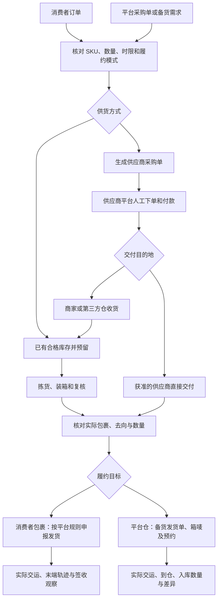

# 订单、采购、发货与物流首版设计草案

日期：2026-10-31。执行 Issue：[#1037](https://github.com/henryxu1008/shuomi-ai-commerce/issues/1037)。Design Basis：Independent Architecture。状态：FROZEN / IMPLEMENTATION_READY。独立第1轮核对 ae76bef05，第2轮仅复核 B1 增量，绑定 bd70e74108c7633b34329123c8f845b636a22d1e 明确准入；此结论先于生产代码修改。用户已授权适配验证、独立评审及准入后的开发；合并、部署、保留实例和真实业务操作不在本次授权内。

## 1. 已确认范围与交付目标

产品依据为本次“梳理系统现有业务流程”会话中的明确决定：

- 卖家自发货和平台托管备货两种流程都作为首版核心流程。
- 生成采购单、跟进交付；实际采购下单和付款先在供应商平台完成。
- 当前没有在用的 ERP / WMS，优先评估成熟开源能力，避免另建一套 ERP。

使用者是卖家运营、采购人员和仓库人员。交付结果是：从一笔真实客单或一笔平台备货需求出发，查清每个 SKU 需要什么、向谁采购、分配到哪里、实际发了多少、平台是否受理，以及货物到了哪里。

用户后续明确批准：优先 SHEIN 美国站客单自发货与托管备货两条路径，先验证 ERPNext，再完成独立架构评审，达到准入后开发。用户进一步批准：托管按当前授权供应商的原始备货单交仓，无法证明销售市场时明确显示未知；客单自发货仍严格限定美国站。北/南大区不等于美国，不以本地 Store 的 shein-us 标签替代采购单市场证据。TikTok Shop、Walmart、TEMU 不属于本轮实现范围。

本轮已有 [ERPNext 隔离适配验证](erpnext-shein-fulfillment-fit-v1.md)；独立评审和 Issue Ready 完成前只允许设计及明确的非正式 Spike，不修改正式生产业务路径。现有实例和数据始终保持原状。

## 2. 现有能力与必须补齐的边界

当前基础：

- [Store 订单与物流只读合同](store-center-platform-observations-v1.md)：当前企业、成员及店铺授权、SHEIN 客单读取和物流查询、同步范围与观察时间；原阶段明确由平台处理发货和售后。
- [订单观察模型](../../internal/storecenter/observations/model.go)：`OrderItem` 保存平台商品身份等观察，未形成执行所需的数量分配模型；原 allowlist 刻意不保存收货地址和联系方式。
- [Supply Market](supply-market-v1.md)、[我的供应链](my-supply-chain-shein-v1.md)：当前来源、商品与供应商上下文，以及商品上架资料；它们不拥有采购订单、库存或出库事实。
- [当前 POD](pod-design-agent-v1.md)：图案、设计资产和设计执行，不代表已经实现生产采购、下单或订单履约。
- 继续复用当前 Store 官方连接、IAM/Casbin、Temporal、资产存储、审计与 Console/BFF；不借 Commercial/Ecoservices 服务订单承载消费者商品订单。

根本边界是“读取平台状态”与“执行履约”职责不同。不能把只读订单 DTO 增加几个按钮就当成采购、库存和发货系统，也不能让商品上架状态承担商品实物履约状态。

本次新增设计将原只读范围向履约扩展；旧只读生产入口继续遵循原合同，只有新设计通过准入并接线后才开放执行。

## 3. 两条核心业务路径

卖家自发货：同步客单 → 确认 SKU 与当前地址版本 → 库存预留或采购 → 供应商交货/仓库拣货 → 包裹与数量复核 → 按官方动作顺序申请面单、预约或申报发货 → 查看原操作回执与物流。供应商代发只有在当前平台、履约方案和承运方式允许时可选；不能默认任意国内直发均合规可用。

平台托管：同步平台发给卖家的采购/备货需求 → 确认目标仓、数量、交仓时间及箱规 → 库存预留或供应商采购 → 收货与装箱 → 创建原平台备货发货单/预约 → 交承运商 → 跟踪到仓 → 核对平台实际入库与拒收、短收差异。平台仓后续向消费者履约，以平台提供的观察为准，不由本系统代报消费者已发货。

已有库存可以直接预留和出库，不强迫每笔订单先采购。供货方式可以按需求行拆分，但必须保留每件数量和来源，不能按商品名称自动匹配。

## 4. 单据与事实所有者

| 对象 | 业务含义 | 唯一权威来源或建议 owner |
| --- | --- | --- |
| 平台客单 | 消费者向卖家购买商品 | 平台；本地保存有来源及时间的观察 |
| 平台采购/备货单 | 平台要求卖家向指定仓交货 | 平台；与供应商采购单分开 |
| 内部履约需求与分配 | 原需求行、数量、供货方式、目的地和关联单据 | ERPNext 原需求/销售/物料单据及行级关联；Fulfillment 仅保留原平台身份和执行绑定 |
| 供应商采购单 | 卖家向供应商采购的商品与约定 | 首选 ERPNext Purchase Order；实际外部下单证据独立登记 |
| 收货、库存、预留、出库 | 合格实收、可用数量和实物出库 | 首选 ERPNext 原单据与库存账；硕米不另建可写库存账 |
| 包裹/箱与交接 | 哪些需求行、多少件、装在哪个包裹/箱 | 关联 ERP 出库/发运事实；平台 package ID 保留原身份 |
| 平台履约操作 | 申请面单、预约、申报发货的原命令和结果 | Fulfillment 操作回执；与商品 Listing Submission 分开 |
| 物流观察 | 承运商/平台提供的节点和异常 | 对应承运商或平台；保留来源和观察时间 |

必须明确三种常见误判：供应商已发货不等于消费者订单已发货；平台已接受申报不等于承运商已揽收；承运商送达平台仓不等于平台已完成入库。

Walmart 的 `purchaseOrderId` 在 Marketplace 客单履约接口中是原平台订单身份，不得仅因字段名含 purchase 就归为我们向供应商采购的单据。

## 5. 开源复用与架构建议

采购、分批收货、库存预留、拣货、出库和供应商代发优先评估 ERPNext，消费其标准 Purchase Order、Purchase Receipt、Stock Reservation、Pick List、Delivery Note/发运能力，通过 Frappe API 集成；不复制同一套可写采购和库存事实。

固定 ERPNext v15.124.3 / Frappe v15.125.0 的隔离 Spike 已验证采购、分批收货/交付、库存预留、并发不超量、仓间调拨、跨 site 拒绝及原子回执。普通 REST 重复 POST 会建两张单，不能作为正式重试合同。采用原生业务 owner 加本批最小命令适配，准确证据和限制见 [适配记录](erpnext-shein-fulfillment-fit-v1.md)，不把 Spike 作为可部署插件。

ERP 内部需求只表达采购与实物履约安排，不接管平台客单付款、取消或平台采购状态。需求数量、采购行、收货、库存预留及出库分配优先在同一 ERP owner 的事务内校验；硕米不再维护另一份可写的需求数量账。

推荐初始隔离边界为每个接入企业独立 site 与专用最小权限服务凭据；多 Company 标签本身不作为跨企业安全边界。不建设自动开通 ERP 租户的平台；实际运维成本与隔离方案在本设计冻结时确定。硕米登录、企业选择和模块权限继续由现有 IAM 决定，ERP 凭据不进入前端。

实际采购付款仍在供应商平台。系统的“外部已下单/已付款登记”只证明人工登记及其证据，不冒充支付渠道确认，也不从现有 SaaS 企业钱包扣采购款。ERPNext 默认库存会计行为须显式校准；首版不自动扩入银行支付、供应商财务结算或全套会计实施。

物流优先复用平台已有轨迹。确需统一外部承运商时，评估 Karrio 已有连接和 tracking 能力，先验证实际承运商覆盖和凭据条件；不把接入 Karrio、全量承运商或自动买面单作为无关业务前置。

推荐调用链：Console → 同源 BFF → 当前身份/企业/模块与店铺授权 → Fulfillment 用例及窄 Port → ERPNext / 当前 Store 官方 adapter → 持久回执及只读投影。Domain 不直接依赖 HTTP、GORM 或 provider SDK。保留模块化单体装配，Temporal 只编排有界步骤，不拥有采购、库存或平台事实。

## 6. 数量、SKU 与关联规则

- 平台需求身份绑定企业、平台、店铺、原订单与行 ID、履约模式及来源版本；SHEIN 每件 `goodsId` 等实际身份按原合同保留。
- 明确关联当前平台 SKU、业务 SKU、供应商商品与规格、采购单位及换算。图片、标题或相同 SKU 文本不能代替准确关联。
- 允许一条需求分到多个采购行/包裹，也允许同供应商、币种、交付地点和时限兼容的多条需求合成采购单。关联必须到行与数量。
- 创建或调整分配时在权威 owner 的事务中保证：有效分配不超过未取消需求；累计实际出库不超过可履约数量；同一库存不被重复预留。平台取消或数量变化后，冻结尚未执行部分，重新确认差异。
- 收货分别登记合格、拒收和短缺数量，只有合格实收进入可用库存。代发不伪造“入我方仓”或再扣一次本地库存。
- 包裹拆分/合并必须受当前平台能力约束；首版不默认跨店合包，不能为了省运费而改变平台原 package 归属。
- 平台仓入库数量和商家发出数量分别保留。库存观察、采购在途、合格现货和平台仓库存不直接相加为“可发库存”。
- 送往平台仓不自动代表商品所有权转移。按实际平台合同选择在途/仓间调拨或销售交付单据；例如仓储托管与平台采购交货不能一律记作同一种销售出库。实际移库、商业所有权和平台入库回执分别核实。

## 7. 状态、事务与恢复

页面同时显示相关的几种状态，避免一个总状态覆盖所有事实：

| 状态维度 | 首版需要表达的结果 |
| --- | --- |
| 需求 | 待关联、缺货、可准备、部分履约、已完成；平台取消/异常独立保留 |
| 采购 | 草稿、已确认、外部下单已登记、待交货、部分交货、交货完成、剩余关闭 |
| 实物 | 待拣货、已装箱、已交接；运输/送达来自对应物流证据 |
| 平台操作 | 待确认、未派发、派发中、明确成功、明确无效果失败、待核实 UNKNOWN |
| 平台仓收货 | 未到仓、到仓待收货、部分入库、入库完成、差异待处理 |

采购内部确认、外部下单登记和外部付款登记是不同事实。状态名称不要求改写 ERPNext 自身状态机；页面按原单据事实投影。

同一个 owner 的数量分配、业务单据与原操作回执优先使用共享事务。ERPNext 侧创建/提交须在其自身事务内绑定唯一外部操作键、载荷摘要和结果 ID；如标准接口不足，仅评估该 owner 内的最小原子命令，不用先查后建替代唯一约束。硕米保存原绑定与核实结果，不要求跨两个数据库全局原子提交。

平台外部动作按“原意图持久化 → 人工确认准确内容 → 发送前重核 → 有界派发 → 保存原回执/原键核实”执行。面单申请、预约和申报分别拥有各自的操作身份，不能伪装为一个跨平台原子操作。

同键不同载荷冲突；网络超时、重启、响应丢失和未经资格认定的错误保持 UNKNOWN，不能自动再发、新建操作或人工直接改成功。只读查询与 webhook 不能仅因当前订单看起来已发货就证明原操作成功。只有官方合同能准确关联原效果时才解除原占用；无查询证明则保持待核实。

只有证明尚未派发的动作才允许本地取消；已交承运商、平台处理中或 UNKNOWN 的动作不得按“取消按钮”倒扣实物事实或释放同一数量再发。改地址、改仓、改单号前重新读取平台允许条件，旧确认失效；原历史保留。

## 8. 授权、隐私与外部副作用

复用当前企业身份、成员、Store grant 和 Casbin，按实际新增边界补足采购管理、收货/出库、履约提交和收件信息读取权限，不另建 IAM 或第二套身份。每次资料披露、平台派发和后台续作重核当前权限、店铺连接和原企业绑定；撤权停止新效果，已发生事实和原未知结果保留。

现有只读订单权限不自动获得地址访问权。收件信息在履约目的下按需获取，限定当前订单、使用者及必要仓库/物流接收方，最小化加密持久化并确定保留期限；不进入普通列表、工作流历史、日志、模型输入或错误正文。需要向供应商提供地址的代发流程必须显示交付对象和用途。

面单文件复用当前私有 Asset/下载授权，不把买家信息放到公开链接。webhook 核签、绑定原店铺与资源、去重并处理乱序；轨迹按发生时间、来源与取得时间展示，不用迟到节点把已签收简单降为运输中，冲突保留可解释状态。

Walmart 发货确认具有客户扣款副作用；TikTok 平台物流/卖家物流与 SHEIN 客单/备货发货有不同前置。新增执行接口必须独立验证当前官方权限和模式，不借用旧 Listing 发布句柄，不模拟卖家后台点击兜底。

## 9. 页面与信息架构

2026-10-31 只读核对 Figma 当前可见、非归档页面 `31:463`「硕米官网」：[订单履约深色 429:5863](https://www.figma.com/design/tg48P46SSXl6TBy9lZwg63?node-id=429-5863) 与浅色 `429:6065`。当前有完整订单履约页，未观察到独立采购、发货、物流整页。新增设计尚非已批准终稿。

建议继续使用“店铺中心 → 订单履约”，在页内提供客单、平台备货、发货、物流的业务视图；“供应市场 → 我的供应链”增加采购管理入口，和现有商品资料阶段分开显示。供应商采购入口与订单详情中的“关联采购”进入同一个原采购流程，不建两套表单或事实。

| 页面/视图 | 主要任务与主操作 |
| --- | --- |
| 客单列表及详情 | 按店铺、时限、缺货/异常查找；从详情“准备履约”进入准确订单 |
| 平台备货列表及详情 | 查原平台采购/备货、交仓时限与差异；“准备交仓” |
| 采购管理 | 按供应商、预计交期和缺货查单；建立采购单、登记外部单号、跟进与收货 |
| 发货工作页 | 原需求与预留数量 → 拣货装箱 → 面单/预约/申报复核；按平台真实依赖分步 |
| 物流视图 | 分别看供应商来货、消费者配送和平台交仓；查看轨迹、到仓与入库差异 |

订单详情保留商品/数量、平台当前状态、时限、关联采购、包裹、回执和操作记录。采购与发货使用独立详情/工作页，列表只负责查找和选择。返回保留筛选与选中来源；保存失败保留输入；切企业清除旧敏感上下文，迟到响应不能写入新企业页面。

## 10. 最小首版与实施顺序

首版 Must：两种需求入口；准确 SKU 与单位关联；采购单及人工外部下单记录；已有库存预留；分批合格收货/代发证据；按平台允许范围装箱和发货；原回执/UNKNOWN；三段物流与平台仓入库差异；当前权限和地址保护。

暂不纳入：自动供应商下单/付款、自动补货预测、SDS 生产采购、自动换供应商、自动退款理赔、完整财务结算、多平台库存自动回写、复杂仓储波次与库位优化。平台原取消与变化必须读取并阻止错误新执行，不因售后执行延期而忽略取消。

默认一个 Delivery Batch、一个主要 PR，以“客单和托管备货均能从原需求走到可核实交付”作为用户结果。里程碑是实现/提交和验证边界，不按文件或内部模块机械拆 PR：

1. 冻结产品入口、SHEIN 首接范围、ERPNext 适配和单一事实 owner；完成适用独立架构检查。
2. 原订单/备货 → SKU/单位关联 → 库存/采购分配，形成两条可继续的真实需求。
3. 采购单、人工外部下单登记、分批收货/代发，打通两条供货路径。
4. 两类发货、平台回执与 UNKNOWN 核实、物流和入库差异，一次集中最终检查后交付用户试用。

正式执行 Issue 必须记录使用者、结果、Scope/Out of Scope、Design Basis、owner 和当前准入；本草案不把 Issue 改为 Ready，也不启动生产实现。高风险检查关注新增数量/状态/隐私/平台副作用边界；最终检查关注两条完整用户路径，未变化代码和证据不重复全面评审。

## 11. 验证与待定项

复用既有测试、隔离 PostgreSQL/Temporal 和平台官方 sandbox，不扩建专项验收平台。必要目标包括：两种需求正常走通；部分到货/出库及单位换算正确；并发分配不超量；平台取消阻断新发货；外部创建及发货丢响应保持原操作；撤权/跨企业/敏感地址拒绝；重启后原单、数量与回执可恢复。

正常试用须交出入口、配置要求、操作步骤、保存位置和已开放平台模式。源码自检、CI、独立检查、真实渠道联调和用户验收分别记录，不用测试通过替代平台准入或用户验收。

正式实现的具体合同见第13节。运行时仍需真实配置：每企业 ERP site/密钥、地址加密与保留参数、原仓库/承运方式、实际 SHEIN 应用权限。缺配置仅关闭对应能力，不能以合成数据、默认权限或旧服务兜底。独立评审可把真实必要的增量验证归 IMPLEMENTATION_TEST；未满足 Must 仍阻止合并。

## 12. Legacy decision 与参考依据

Legacy decision: RETIRE（已登记退休的旧 owner 继续按原决定退休；本轮不执行代码删除。正式差异若实际抽取旧行为，须另列对应 EXTRACT 决定）。

Reusable behavior: 仅复用仍有效且已归当前 owner 的官方连接、签名 transport、权限、资产、审计与确定性恢复原则。

Current owner: Store/Marketplace、Product/Collection/Asset、现有 IAM 与 Temporal，以及本方案待冻结的 Fulfillment/ERP owner。

Cutover/deletion condition: 新执行路径不得依赖已 RETIRE 的 Task、旧 ListingKit、旧租户或浏览器自动发货；当前只读查询仍有独立价值，不因新增履约而删除。不进行旧数据迁移、兼容包装、双写库存账或恢复已退休 owner。

官方资料核对于 2026-10-31，说明接口和开源能力，不证明本项目已接通：

- [SHEIN 采购单](https://open.sheincorp.com/zh/documents/apidoc/detail/3001059-1000002)、[创建发货单](https://open.sheincorp.com/zh/documents/apidoc/detail/3001679)、[全托管模式](https://open.sheincorp.com/zh/documents/system/495d5251-5c71-4b67-8b6f-c7973b01fd12)。
- [TikTok Ship Package](https://partner.tiktokshop.com/docv2/page/650aa4f1defece02be6e7cb1)。
- [Walmart Ship order lines](https://developer.walmart.com/global-marketplace/docs/ship-an-order-mp)：确认前置和扣款副作用；WFS 是入仓合同，不使用卖家客单发货接口替代。
- [ERPNext Purchase Order](https://docs.frappe.io/erpnext/purchase-order)、[Purchase Receipt](https://docs.frappe.io/erpnext/purchase-receipt)、[Stock Reservation](https://docs.frappe.io/erpnext/stock-reservation)、[Drop Ship](https://docs.frappe.io/erpnext/drop-shipping-in-erpnext)、[Delivery Note](https://docs.frappe.io/erpnext/delivery-note)。
- [Frappe REST API](https://docs.frappe.io/framework/user/en/api/rest)、[ERPNext Periodic Inventory](https://docs.frappe.io/erpnext/periodic-inventory)。
- [Karrio Tracking](https://www.karrio.io/docs/products/tracking)、[Karrio 开源仓库](https://github.com/karrioapi/karrio)。

## 13. 首版正式合同与评审边界

### 13.1 路径、模式和平台事实

客单只接受当前已授权 Store/Supplier、salesSite=shein-us、stockMode=3 的原订单；需要存在明确可用的商家自履约方式、正常 printOrderStatus、原商品行/包裹成员及平台当前发货时限。未知枚举或无法验证的订单拒绝新执行，仍可按权限查看原观察。首版不自动切换合作物流模式、不替消费者 stockMode=1/2 发货。

托管仅从当前授权全托管供应商读取原采购单；采购接口为 GET /open-api/order/purchase-order-infos，保留 orderNo/type/status/sceneType、原 SKU 及各数量、交仓/取件时限、storageId 和 deliveryCheckRuleFields。JIT 母单、sceneType=3 的无需发货需求不能变成可发订单；急采/普通备货及首单规则从当前原单/官方规则核对，不把 ERP 部分收货自动当成平台允许部分发货。countryMarket 只保留其原含义，不映射成美国。

自发货调用独立官方路径：原订单详情 → 显式地址操作 → 官方 express-channel → 实际交运及准确包裹/行/运单 → POST /open-api/order/import-batch-multiple-express → 原结果及物流观察。上传运单受理不等于 SHEIN 已标发货，揽收和平台状态另行展示。

地址接口 POST /open-api/order/export-address 的 handleType=2 会将待处理改为待发货并限制买家改地址，必须是单独的“接受订单并获取履约地址”明确确认命令；列表、预览及刷新不调用此 mutation。handleType=1 的地址读取也须当前履约隐私权限，不能继承原订单只读权限。原状态和 printOrderStatus 不满足时按官方条件拒绝，不以重试绕过。

托管按 GET /open-api/shipping/basic 的当前地址、仓库、承运商/路径/打包选择构造 POST /open-api/shipping/orderToShipping；准确保存返回的发货单、包裹/箱唛身份，交仓数量和平台原采购单的 receiptQuantity/storageQuantity/defectiveQuantity 分开显示。不创建新的平台采购单、不自动取消或修改平台发货单，不自动接受超发/少发。

官方来源：[客单自履约方案](https://open.sheincorp.com/zh/documents/system/b86df826-638d-4128-9f5e-c7b20d8cf28e)、[地址接口](https://open.sheincorp.com/documents/apidoc/detail/3001466)、[上传运单](https://open.sheincorp.com/zh/documents/apidoc/detail/3000322-2000001)、[采购单](https://open.sheincorp.com/zh/documents/apidoc/detail/3001059)、[发货基础信息](https://open.sheincorp.com/zh/documents/apidoc/detail/3000561)、[创建发货单](https://open.sheincorp.com/zh/documents/apidoc/detail/3001679)。上述能力合同和项目对“市场未知”的处理分别取证。

### 13.2 ERP 单一 owner 与最小扩展

正式扩展落点为 extensions/erpnext-fulfillment 的标准 Frappe app；Spike 位于 .local，禁止正式 import/copy 为运行消费者。原生 Sales Order/Item 表达内部数量需求，Customer 为企业内系统交易对方，不复制消费者个人资料。以 source_kind=consumer_order 或 platform_supply 分开保存原平台来源、原行与绑定摘要，内部单据状态不覆盖平台状态。

平台为原商业买方的供货交付可按批准合同消费原 Delivery Note。商家仍拥有且已由原 SO/SRE 预留的交仓，固定使用原生内部 Delivery Note：原需求使用本公司专用 Internal Customer，represents_company 必须等于该 ERP company；原 SO item 为 so_detail/against_sales_order，DN item.target_warehouse 指向该公司配置的不可再分配在途仓，币种为公司基础币种。原生 DN 在同一 ERP 事务内消费准确 SRE、推进原 SO 交付数量、减源仓并增加在途仓，总拥有数量不减；不能使用 Stock Entry 绕开原 SRE，不能分次解除预留再调拨。交仓页面将此内部 SO 的 delivered_qty 命名为“已移交/发出数量”，不冒充 SHEIN 已收货/入库。

movement_kind 由当前已确认的供货/所有权配置和原需求固定，缺失则拒绝，不接受浏览器临时改为内部/销售；不从地址或全托管名称猜所有权。内部 Customer、company、基础币种及源仓/不可再分配在途仓由当前 site 配置和原单校验；原生约束不能放宽。后续有准确平台入库证据时单独核对实际数量，原采购单的累计 storageQuantity 不足以证明本次某个包裹的入库，不自动按它调拨或关闭原 UNKNOWN。非基础币种采购只消费 ERP 原币种与明确配置的汇率，不自动外呼，不补 rate=1；内部调拨需求不使用跨币种。SaaS 钱包、供应商付款和财务结算不接入本批。

拟新增的本批 ERP operation DocType 仅拥有命令幂等/进度和平台副作用回执，字段为 operation_id、organization/site binding、actor/member、purpose、input_digest、source_binding_digest、target_doc/line refs、revision、stage、result/error 及时间。业务数量、预留、实收/实出仍归原生单据；关联扩展字段不另存可写库存余额。

每个 ERP site 的组织绑定由安装配置固定，不接受请求任意更改；每企业独立 site/数据库和专用服务凭据，不以 Company 参数过滤替代隔离。安装者执行原 Frappe app 安装，serving 不安装 schema。Frappe 原生最小 Custom Role/DocPerm 允许本批具体业务，不使用 Administrator、System Manager 或通用宽采购/库存角色。秘密只保存于私密运行配置，禁止 Console 返回和重定向转发。

固定命令集合：绑定/确认内部需求、创建/确认采购单、外部下单登记、原采购行收货、原需求库存预留、准确行/数量/包裹出库、原平台动作 prepare/claim/result/read。各命令只接受其窄 typed payload，不开放 doctype、任意方法名、过滤表达式、SQL、provider URL 或 ERP 任意 CRUD 代理。

同键同摘要返回原结果；同键异摘要、组织/目的/来源/成员变化返回冲突。ERP 创建/提交业务单、数量变更与回执在同一数据库事务；原单据创建后故障全部回滚。外部调用结果未知时先读原键，未能完整确认原事实则 UNKNOWN；读取失败不是未执行证明。字段唯一约束和当前原单行/数量、ERP native 预留校验均在同 owner 事务中执行，不能用 Go 侧先查后写替代。

### 13.3 平台派发与恢复

ERP 本批 operation 是平台副作用意图、占用和结果的唯一持久 owner；Go 不复制另一张可写 attempt/恢复表。平台动作与对应 ERP 实物单据引用绑定，但两者不伪装为跨系统原子操作。Prepare 固定当前来源、ERP 实物行/版本、准确承运商/包裹与输入摘要；用户 Confirm 绑定这一版本。改数量、仓、地址、物流或来源后旧确认失效。

平台动作 stage 为 PREPARED → CONFIRMED → CLAIMED → DISPATCHING → SUCCEEDED / DEFINITIVE_NO_EFFECT / UNKNOWN；只在未派发且可证明的阶段取消。ERP 原子 CAS 确保同一动作只有一个派发者；DISPATCHING 在平台发送前持久化，不以租约过期或重启授权再次发送。ERP claim/派发标记响应丢失时不向平台发送，按原键核实；已有 DISPATCHING 而无原结果保持 UNKNOWN。先持久化标记后本进程未收到确认的少量不确定窗口不会以“肯定没发”自动释放。

正常平台响应须经当前官方 adapter 校验完整身份及逐项结果后，才能保存 SUCCEEDED；HTTP 2xx/code=0 单独不能替代完整结果。5xx、超时、取消、响应丢失、截断或不具备确定无效果合同的拒绝均 UNKNOWN。SHEIN 的可见当前状态、其他应用已上传同一运单、普通签收事件都不能证明本次原操作成功。不具备准确原效果查询合同的动作只显示待核实和官方处理入口，不提供自动重发、换键或人工改成功。

Temporal 复用已有 SDK，只传 ERP site alias、org、operation ID；平台 mutation activity 最大执行一次，不使用默认重试。可重试的 ERP 原键调用及平台只读查询沿有界重试；原 ERP 操作和事实不在 Workflow history 中复制。无新 scheduler、Saga 平台、全局 outbox 或人工恢复工具。

### 13.4 身份、数据与资源边界

Console/BFF 从现有已验证会话取得当前 user/member/org；Go 每次读、ERP 命令和平台披露/派发重新检查当前 IAM 与 Store grant。新增权限消费现有 Casbin owner：履约读取、采购管理、收货/出库、地址读取、平台执行按独立用途授予，不把原 store.orders.read 扩为写权限。后台使用原 actor/member 与当前授权，不伪造身份；撤权只停止新效果，不抹除已发生事实或将 UNKNOWN 变失败。

ERP/平台调用固定于安装配置和当前 Store registry；禁止浏览器指定 site、组织、ERP URL 或凭据。ERP 通道使用固定 HTTPS origin、正常证书校验、禁止重定向和短 deadline。当前实验回环 HTTP 只用于合成数据 Spike，不能进入正式配置默认值。

地址只在当前授权明确操作中取得，通过现有成熟加密库/ERP site 加密配置保存最小字段、摘要与过期时间，不复制到 Customer、普通订单列表、日志、错误或 Workflow。地址保留期限和加密配置是必须显式设置的运行参数；缺失关闭该能力。到期删除正文并保留非敏感关联，过期地址不能用于新的确认；重新取得时绑定当前原订单。私有面单下载继续校验当前 org/store/purpose，禁止公开链接。

首版列表/批处理最多每页和每个确认20项，单项数量为平台原单位的正整数，供应单位换算绑定已确认配置。输入上限256KiB，平台/ERP 响应上限2MiB，每次 HTTP 最长10秒且服从父 deadline；批次逐项有界处理，单项 UNKNOWN 或授权变化停止后续新副作用。同步/读取采用当前官方分页和窗口，不以一页推算完整覆盖。真实平台规则更严格时从严采用，不放大官方限额。

### 13.5 正式落点与开发验证

- Domain/合同：internal/fulfillment 与 internal/marketplace/shein 的当前领域目录。
- Native ERP 扩展：extensions/erpnext-fulfillment，使用原 Frappe DocType/权限/事务及原 ERPNext 单据。
- Adapter：internal/integration/erpnext 与当前 internal/integration/shein；Store 官方用途仍归当前 Store owner。
- 组合与执行：internal/app/fulfillment、模块本地 HTTP、currentapplication 私密 manifest 与现有 Temporal runtime；不经旧默认装配。
- Console：复用当前订单页表格、筛选、详情、独立工作页和 BFF；采购入口与订单关联采购使用同一流程。按第9节已批准位置扩展，不新增顶层 ERP/WMS 中心。

实现先写当前缺陷/规则的 RED：同键异载荷、并发数量、回滚与丢响应、地址 read/accept 区分、跨 site/店铺与撤权、客单 US/stockMode 筛选、托管原规则/市场未知、发货逐项结果与 UNKNOWN；再做最小实现。原生单据重复约束优先使用已有能力，不把 Spike 脚本变成生产服务或专项验收平台。

开发交付提供一个主要 PR、原生 ERP app 的全新安装说明、当前应用正常启动配置、两条真实入口/步骤/保存位置与缺配置关闭说明。正式源码、准确 CI/独立最终检查、真实 SHEIN、部署与用户验收分开记录。Architecture Review 只对本次实际新增事务、状态、隐私和副作用边界审查，最多两轮正常评审；只有具体 BLOCKER 可重开冻结设计。

## 14. 首轮架构 Finding 与窄增量

第1轮候选 ae76bef05e5afda1f2647ad43f16a14af7c5814e 的唯一 BLOCKER 为 B1：原 SO/SRE 预留后使用 Stock Entry 调拨，不能同时消费预留及推进原需求，命中核心 happy path 无法完成，阻塞实施准入。独立 Reviewer 已核对准确上游源码和真实 Spike，未要求重审其余未变边界。

分类：BLOCKER。Action：仅冻结§13.2的原生内部 DN 路径，并在同一已预留商品验证。增量 Spike f1eaa573 已重现旧 Stock Entry 拒绝；原生内部 DN 部分移交2后，源仓5→3、在途0→2、原需求已交0→2、剩余预留5→3，总拥有数量5且无GL；DN/SRE/库存更新后、回执提交前故障时，四项原事实和回执一起回滚。准确结果见 [适配验证](erpnext-shein-fulfillment-fit-v1.md) 与固定JSON。

Reviewer 其余建议归 IMPLEMENTATION_TEST：不同 operation ID 不能绕过同一实物/平台效果的 UNKNOWN 占用；实时权限/地址用途/版本漂移；原生容差、单位换算和部分收货/出库的准确约束。它们必须在正式实现和必要验证中收敛，当前不据此增建通用机制或扩大架构评审范围。原独立 Reviewer 已只读核对 B1 的真实三文件增量、脚本哈希、原始 f1eaa573 结果和准确上游约束，绑定 bd70e74108c7633b34329123c8f845b636a22d1e 明确 IMPLEMENTATION_READY；B1关闭，不重复全局评审。Reviewer未重新执行有写入的probe，该结论不是真实平台或用户验收。

### 实现澄清与当前验证状态

用户随后确认：暂时没有可证明允许自发货的美国站店铺/订单，继续完成开发，真实自发货保留待联调状态。没有扩大真实渠道或保留实例操作授权。

装箱消费原生 Delivery Note 草稿（docstatus=0），准备/打印平台单据不会提前扣库存；实际交接才提交原草稿，仍使用已批准的原 SO/SRE 与内部 DN 原子库存更新。原操作聚合在 Frappe 原生子表中保存每件 goodsId 的唯一效果占用，不形成第二数量账；换包裹或 DN ID 不能解除原 UNKNOWN。托管发货占用原备货单，不能换单据重复发送。该澄清收敛既定 IMPLEMENTATION_TEST，不新增事实 owner 或跨系统事务协议。

正式官方文档在浏览器动态内容中已核对：[备货履约](https://open.sheincorp.com/documents/system/a880d468-3c56-4dee-b8d6-5c6ff8be756f)、[智能拆包准入](https://open.sheincorp.com/documents/apidoc/detail/3002042)、[发货基础资料](https://open.sheincorp.com/documents/apidoc/detail/3001971)、[发货单面单](https://open.sheincorp.com/documents/apidoc/detail/3001293)。商家渠道查询的当前合同为 POST /open-api/order/express-channel，语义只读；以当前正式文档为准。地址 handleType=2 另要求原单已选 orderLogisticsType=2，不自动替用户切换。智能拆包接口的 countryMarket 说明不能替换用户已经确认的原采购单市场未知处理。

实现仍为 In Progress。ERP 原生扩展、固定 HTTPS adapter、当前 Store/IAM 用途和一次平台派发已形成；Console/BFF、完整联调与最终交付检查尚未完成。当前正式原生测试覆盖10项并通过；相关 Go 包通过。真实 SHEIN、部署及用户验收为 NOT_RUN，不能把它们写成已打通或已验收。
