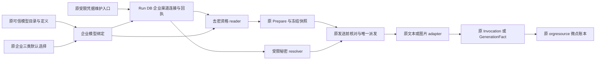

# 渠道凭据与模型定义分离：最小设计候选

Status: **PRODUCT_DECISIONS_CONFIRMED / DESIGN_CANDIDATE / NOT_IMPLEMENTATION_READY**。Design Basis: **Independent Architecture**。
Refs [#134](https://github.com/henryxu1008/shuomi-ai-commerce/issues/134) / #128。日期：2026-11-04。

用户已明确回复“认可 D1–D4，仍不实现”，确认本文 D1–D4 产品决定；随后授权原负责人在原工作区提交、推送 design-only Draft PR 并核对准确 HEAD 的 CI。
架构复核 NOT_RUN，未授权实现、新增派工或评审、合并、部署或真实操作；提交本候选不授予 IMPLEMENTATION_READY。
本地调查 HEAD `d9a5c7bd3351b66a23fc66259e459d91333e86ad`；只读 main 基线 `c26c3f522bc14269711baf3a98f7470876c27487`。
#1078 已正常合并，本候选不继承它的架构 Ready 或扩大其工程通过范围。#1075 保持原负责人，其生命周期/公共配置改动不由本任务重写。

## 1. 用户结果、依据与范围

使用者是受限渠道维护者、企业模型配置管理员和企业成员。维护者为同一企业配置一次渠道连接及 Key，多个已准入模型显式引用它；
企业管理员仍在一个位置选择文本、图片生成、多模态默认模型，所有成员沿原业务入口使用。
例如同一 OpenAI 企业连接同时服务 Mini 文本、Mini 看图和 Flare 生图，不为三个消费者分别保存 Key。

依据：用户本轮明确要求多模型复用、企业隔离、凭据轮换、历史调用恢复和一套计费；
[企业统一模型配置](enterprise-shared-model-configuration.md)、[Flare 图片参考估算](openai-flare-image-generation.md)、
[运行合同](product-agent-runtime-contract.md)、[领域边界](project-boundaries.md)及
[全新系统基线](../product/greenfield-no-legacy-migration.md)。
官网公开价只作为已批准的版本化参考价格；不恢复精确账单/厂商完整硬上界研究，不修改舍入、点数或调用预算。

UI / Product Authority 沿[当前 UI/IA](../product/final-ui-ia-authority.md)和现有「模型与费率」：
Figma `tg48P46SSXl6TBy9lZwg63`，账户中心 `31:463`，模型配置区域 `7658:2087` 及其历史/不可用状态。
本候选只保留企业三类选择及去密状态，不新增页面、普通成员 Key 输入或自助 BYOK；Figma 实查、修改、视觉验收均 NOT_RUN。
截图仅是用户体验参考，不是本系统权限、存储或收费 Authority。

### 本次不做

- 不新增 AI 网关、路由调度平台、密钥托管服务、自动模型发现或任意 endpoint；不自动开放渠道列出的全部模型。
- 不改变默认 OpenAI 准确型号或撤销 GPT/Gemini/Qwen 支持目标；本候选不顺带实现尚缺的厂商适配/计量。
- 不开放跨企业共用 Key、个人覆盖、全局 Key fallback 或平台 Key 池；同一家服务商可有不同企业/账号/地域连接。
- 不增加余额、计费引擎、价格 current、恢复 worker、调用次数或费用上限；不自动重试、换型、换渠道。
- 不迁移保留库、不导入旧凭据、不重解释历史事实、不切换运行实例；不开发新的通用 IAM/KMS/审计平台。

## 2. 当前事实与根因

| 当前依据 | 已核事实 | 本候选的局部变化 |
| --- | --- | --- |
| `internal/integration/openai/credential_store.go` / `credential_metadata.go` | 凭据行同时保存组织、ClientName、Key、BaseURL、Model、协议；版本含 Model，解析结果由该行确定模型 | 拆出企业渠道连接，模型与协议由可信模型定义决定，凭据版本不再由模型名称决定 |
| `internal/integration/aicapability/routeconfig/catalog.go` | 模型准入匹配凭据行的 Model、版本、endpoint | 仍精确核对，但分别绑定模型定义版本和连接凭据版本 |
| `internal/app/runtime/currentapplication/model_route_pricing.go` / 图片 worker `generation_runtime.go`、`generation_quote.go` | 文本从 Run DB、图片从 ImageAgent DB 读取凭据，目录另读图片凭据投影 | 新空库采用一个凭据 owner，图片侧注入该 owner 的窄 reader，不向图片库复制 Key |
| `internal/aicapability/routeconfig/shared.go` | 企业三类选择只保存模型引用，价格与秘密不在选择 payload 中 | 保留此结构与原 CAS/current，模型引用再指向企业连接 |
| `internal/aicapability/invocation.go` / `internal/imageagent/generation_fact.go` | 原 Invocation、intent/fact 已保存 CredentialReference、ConfigurationVersion、模型、价格和恢复事实 | 在这些原字段/快照中绑定新版本组合，继续由原 owner 恢复，不另建调用事实 |

一个需要明确处理的现状：现有 AI 凭据保存路径直接写 `APIKey` 字段，未在该路径调用加密；`json:"-"` 只防序列化，不代表静态加密。
本候选只对新连接复用仓库 `internal/integration/credentialprotection.AESGCM`，不读取、扫描或加密改写保留库。

## 3. 最小对象与唯一 owner

| 对象 | 内容 | owner / 落点 |
| --- | --- | --- |
| 企业渠道连接 | org、connection ID、渠道/供应商身份、账号标签、地域/受控服务 origin、启停、revision、保护密钥 ID、加密 Key | 沿现 AI 凭据职责抽取到 provider-neutral 的 AI capability 凭据 owner；候选唯一存储为原 ProductAgent/Run DB |
| 模型定义 / 企业绑定 | 准确 model ID、定义版本、支持类别/用途、受控协议/endpoint 构造、用量映射、输入/输出/调用限制、price 引用、connection ID | 复用原 `Catalog.Definition`、route policy 和可信目录；原组织 scope 不变，不新建模型管理事实源 |
| 企业默认选择 | 默认渠道及 text/image-generation/multimodal 的模型引用 | 原 `SharedModelSelection` / Repository / revision/current/CAS / 回执；不保存 Key 或复制价格 |
| 调用与费用 | 原输入、模型、连接版本、配置/价格/FX、预留、观测与结果 | 原 snapshot/Invocation、GenerationIntent/GenerationFact/artifact 和 orgresource；不移库、不复制账单 |

连接身份以 `(organizationID, connectionID)` 唯一；同一厂商可以有多个连接，模型显式选择其中一个。
连接的供应商/账号/地域/受控服务身份不得以一次“换 Key”偷偷改成另一条渠道；更换身份创建新连接并显式改模型绑定。
同一连接可以支持不同已准入协议，协议和具体路径仍由各模型定义确定；不能把一个 SDK client 或一套参数直接用于所有模型。
Key 的访问范围来自该账号；模型列表可见、协议兼容或同名厂商都不等于该 Key 对某模型有执行资格。

### 3.1 存储与事务候选

在新空 Run DB、原凭据 owner 的事务/安装入口内增加有界的连接存储；不新增数据库或服务：

- `ai_channel_connections`：组织+连接唯一、当前 revision、去密元数据、`protection_key_id`、`secret_ciphertext`、启停；没有 Model 列。
- `ai_channel_connection_receipts`：组织+actor+request key 唯一，命令指纹、连接 ID、结果 revision、去密结果；只用于连接写命令的原键恢复。
  原配置 Repository 的 CAS/回执实现模式复用，不把该表扩成通用命令账本。模型定义继续沿原可信配置，不增加模型表。

连接更新和命令回执必须在同一 Run DB 本地事务提交；不写 ImageAgent DB，不持有该事务进行 provider HTTP。
receipt 不保存 Key、ciphertext 或可离线猜测 Key 的普通 hash；含秘密的请求指纹采用服务端带钥摘要并版本化，摘要不向前端/日志投影。
带钥摘要使用成熟标准原语及独立用途的派生密钥，复用现私密保护材料注入；不得自己实现密码算法。
相同 key/相同完整请求先回原回执；相同 key/不同 Key 或元数据冲突；expected revision 不符冲突；ACK 不明只找原回执，不再轮换一次。
此为候选的新增持久化合同，尚未安装 schema 或获得实现准入。

### 3.2 接线

contract → implementation → injection → consumer 的最小变化：

1. 原 `aicapability/routeconfig` 引用“连接身份/版本+模型定义版本”；不让领域代码获取明文 Key。
2. 凭据存储/组织限定解析从 `integration/openai` 的模型同行结构中 EXTRACT 到 provider-neutral 的当前凭据 owner；
   去密 metadata reader 与秘密 resolver 是同一记录的两种受限读取，不是双份存储或新事实源。
3. `currentapplication` 为目录/预览注入去密 reader；为真实文本发送边界注入受限 resolver。
   图片 quote 只读元数据；图片 worker 发送路径注入同一 Run DB 的窄秘密 reader，替换图片库模型行读取。
4. 原 factory/manager 将“可信模型定义+准确连接版本的秘密”组装为各自 SDK 参数；不能把模型 ID 从浏览器或凭据行带入。
   OpenAI adapter 仍只做传输，不直接依赖领域账本；Mini 看图限制和 Flare 专用协议不能被通用连接放宽。
5. 覆盖原模型目录/`model_route_runtime`、受限 provision、文本/看图、图片 quote、白底/来源编辑/artwork worker；
   任何新正式消费者都不回落 `ai_client_credentials`。只共享凭据，不合并各消费者的业务事实与权限。

与 #1075 的组合沿其“关闭新执行、保留完整管理和历史”合同：管理与历史读不以秘密解密、图片 worker、Temporal 或 provider 试连为启动前置。
执行关闭时可读去密连接/原历史，不能为资格检查启动 worker 或构造可执行 provider；缺 reader 的原未就绪投影保留。
实现前只由同一公共 owner 核对届时 main/该 PR 的实际组合，当前不派工、不并发修改其文件。

## 4. 企业、权限与秘密边界

- 所有读取和写入都用服务器验证的 effective organization；connection ID、模型名、worker payload 中的 org 不能替代身份验证。
  `(org, connectionID)` 定位后仍核模型的原组织 scope/用途/权限；相同 ID 在另一企业不可借用，原成员行或全局 Key 不 fallback。
- 企业模型选择仍只需已有 `workbench.agent.configure`；选择模型不获得配置 Key、修改参考价或扩大业务执行权限。
  Key 创建/轮换/停用仍由原受限部署/凭据维护角色操作；本阶段不增加浏览器 Key 编辑和新企业 BYOK 权限。
- Key 入库前使用现 AES-GCM 封装，加密材料从原私密配置注入；AAD 绑定 org、connection ID、revision 和渠道身份。
  保护密钥缺失或认证失败拒绝写入/发送，不降为明文；Key 轮换不同于保护主密钥轮换，后者不纳入本候选。
- 配置/目录/浏览器 reader 只 SELECT 去密 view；原 metadata 角色不扩成可读 ciphertext。
  执行侧使用显式注入、仅目标表的只读 secret resolver；图片 worker 的 Run DB 接入在原连接校验/角色安装中给出，不扩大为 Run 库 owner。
  实际角色授权、连接凭据和保护材料准备保持 UNKNOWN，不操作现有角色或数据库。
- 仅最终受控传输在内存中拿到 Key；prompt、Tool、snapshot、ledger、artifact、回执、日志、缓存 key 不包含 Key/ciphertext。
  client 缓存必须绑定 org+连接+revision+协议等有效配置身份；轮换后不复用旧缓存发送，不以 Key 明文作缓存标识。
- endpoint/协议仍由原服务端 allowlist 与 adapter 校验，重定向/隐式重试禁令保留；不以配置渠道增加任意 URL/SSRF 入口。

## 5. 轮换、停用与发送前核对

连接 ID 稳定，revision 严格前进，Key A→B→A 也产生新 revision；不以 Key 相同、启停回切复活旧报价。
模型定义版本只描述模型及连接引用，不包含当前 Key revision；有效 profile/quote 同时绑定两者。
因此同一连接轮换一次即影响引用它的多个模型，不需要重写每条模型定义或企业三类选择。

| 时点 | 候选行为 |
| --- | --- |
| 维护者轮换/停用 | 对准确 org/connection、expected revision 做 CAS；本地事务写新 revision/加密 Key 或启停与去密回执。轮换不验证真实 provider，不声称账号有权限 |
| 新 Prepare | 原目录读取有效模型、连接新 revision、参考价/FX及该用途限制，形成原快照；没有有效 Key/reader/资格则未准备好，不能改走别的连接 |
| 旧 Prepare 尚未派发 | 原键找回原准备；如果冻结连接 revision 已失效，原准备可读但不能发送，要求用户显式重新准备；不在同一次 Start 里自动更新 Key/模型/价格 |
| 已到原 claim/预留边界、尚未完成发送前核对 | 仍走原唯一 owner 的最终授权与准确版本核对；变化则不发送。是否有 no-send 证明及可释放 R，只按原 owner 的既有事实判定，轮换本身不是证明 |
| 发送前最后核对通过之后轮换 | 已获原一次发送资格的调用可按冻结版本完成/观测/结算；停用或轮换不承诺撤销远端已在途请求。新请求/后续步骤继续 fresh 核对 |
| 已发送、超时/中断/响应丢失 | 原 Invocation/fact 及 UNKNOWN、预留保持；不借新 Key 查询代替证明，不换键重发，不因轮换自动释放或结算 |

最终 resolver 对同一连接行取得一致的元数据、revision 与秘密，比较原冻结身份后才组装一次发送；不能先查 v1 元数据后取 v2 Key 并冒称匹配。
原 claim/fence、事务、次数、deadline、输入/输出边界不变；不新增跨库锁、分布式撤销事务、发送许可表或 scheduler。
凭据在最后核对之后改变的有限在途窗口已由本轮 D2 产品决定确认；本候选未将“立即停止所有在途请求”写成保证，也未宣称完成架构或运行验证。

## 6. 历史调用、恢复与版本切换

新合同的原 profile/snapshot 中记录准确 org、模型定义版本、连接 ID/revision、endpoint/协议、类别/用途、输入摘要、价目/FX/策略版本和预算。
原 `CredentialReference` 使用可校验的非秘密版本引用（候选 `channel-credential-v1`），原 `ConfigurationVersion` 绑定完整有效组合；
不新建第二份“调用绑定快照”表，不把当前连接重新解析结果覆盖历史。具体编码随设计复核固定，不复用旧格式假装等价。

| 原事实 | 可做 | 禁止做 |
| --- | --- | --- |
| 原准备回执、未发送且已失效 | 原权限下按原 key 展示冻结模型/连接版本和失效原因 | 更新原回执为新 Key、自动续跑、自动建立新预留 |
| 原 Invocation 或 GenerationFact 已有结果、费用、结算回执 | 只读原 owner；历史页不需要原 Key 仍有效，也不以当前目录/价目重算 | 用当前模型/费率补造历史，因连接停用隐藏原费用 |
| 同一新合同内已观测可信 usage/已保存 bundle，账本或发布 ACK 丢失 | 原 Recovery/账本/artifact 以原 invocation/intent、输入和 key 对账/恢复；只重做原合同允许的本地持久化步骤 | 再调用 provider、更新 credentialReference、重算当前价格 |
| 无法证明已发送与否，或已发送但没有结果/完整基础用量 | 保持原 UNKNOWN/R，返回原可用状态和证据缺口 | 轮换 Key 后重发、假定零费、扣尽 R、自动释放 R |
| 连接/密钥已删除、禁用、reader 不可用 | 原权限允许的原账单/结果/回执仍可读，已观测事实的原本地恢复不依赖新发送资格 | 为显示历史解密旧 Key、探测 provider、回退旧库 |
| 切换前模型同行凭据格式的历史运行 | 保留实例与原证据不动，历史由原版本按原权限读取已存快照/回执，不解析成新连接 | ID 映射、导入/复制旧 Key、跨版本续跑/重发/新采用或默认接新 Key |

旧格式不是新执行资格。新版本只执行新合同；缺少完整新 schema/reader 的保留库启动/执行拒绝，不自动升级。
新版本不提供访问旧 schema 的兼容读取器；保留实例仍保持原状，本设计不对它执行“切成只读”或关闭操作，也不承诺新安装页面能显示未导入的旧库历史。
“恢复”在本候选指原键读回、可信观测后的原本地结算/发布恢复，不赋予 provider 重发权限；不新增跨版本恢复 adapter。
既有已批准资产本身仍由当前资产 owner 正常授权读取，能否作为一次全新请求来源沿原来源合同判断；这不构成把旧运行续跑或重新采用。
保留实例上的实际历史行为没有执行；其适用性和证据缺口仍 UNKNOWN / NOT_RUN。

## 7. 一套计费及不变量

渠道凭据只授权访问，不携带用户扣点价。模型绑定引用原平台参考价，执行冻结价目/FX与用量映射；
同一型号在不同连接的权限、可用性可不同，不能因此抄另一连接价格或把账号套餐额度当产品 AI 点数。

- 费用沿同一 `OfficialModelTariff`/参考策略和原 orgresource；R 最终向上、A 最终向下，微点单位与原月限/预算不变。
- 凭据轮换不改变旧价格/FX/预留，也不增加渠道余额、代扣账本、固定按次收费或隐含平台差额承担。
- 文本/看图仍由原 Invocation、图片由原 intent/fact 提供可信用量；缺失/矛盾/超 R 按原合同，不以 Key 通用放宽计量。
- Flare 已批准 D1、超 R 证据/隔离、artifact 包、原键及同绑定限制保留。模型与连接解析继续形成原冻结有效绑定，不能因解析重构漏核原绑定；
  真实连接 revision 变更按既有绑定定义参与新准入，不清理原 ObservedOverage/UNKNOWN，不宣称已处置原超额。不同真实绑定不因此增加跨绑定/账号全局封禁。
  若原摘要无法用分离后的准确字段保持该合同，停止报告具体差异，不自行扩大或削弱隔离范围。
- 企业/成员额度、一次 provider effect、claim/fence、资源事务、价格与派发的唯一 owner 不变。

## 8. 新空库切换、Legacy 与最小实现边界

候选是新版本、新空库安装合同。待单独授权实现后，只修改原安装器/schema 检查及所需窄角色；
现模型同行凭据路径不在新正式消费者中继续运行。已有表/签名不符时拒绝，不能就地 ALTER、复制秘密或双读双写。
运行在当前版本的保留实例不动；后续部署、配置准备、数据处置需要各自授权，本设计不提供操作命令。

Legacy decision: **EXTRACT | RETIRE**。

- Reusable behavior：组织限定查询、当前凭据保护组件、可信目录/SDK、配置 CAS/原键回执、本地事务、原调用/账本恢复。
- Current owner：AI capability 的现凭据/routeconfig 职责；provider adapter 只传输，Run/ImageAgent/资源 owner 保持原事实职责。
- Cutover/deletion condition：新空 schema 与全部当前正式读取者完成切换后，退休模型同行凭据读写和原图片库秘密读取；不包裹旧表当新连接服务，不保留 fallback。

最小实现顺序（尚未授权）：连接 owner/保护/事务及新空 schema → 原目录、文本/看图解析 → 图片 quote/worker 的窄只读接线 →
原页面去密状态/历史与既有恢复组合。形成一个用户结果、一个主要 PR；不按上述步骤另派 Writer/Reviewer 或机械拆 PR。
代码文件清单和必要组合基线在候选确认后由同一负责人核定；触及新的身份/恢复/计费边界先报告，不能凭本候选扩大。

## 9. 必要离线验证候选（全部 NOT_RUN）

复用现有 TS/Go、任务临时 PostgreSQL 和合成 transport；不创建 runner、专项验收平台或真实调用前置。

| 不变量 | 最小验证位置/方法 |
| --- | --- |
| 一份连接被 Mini 文本/看图、Flare 引用，模型协议分别准确 | 原 routeconfig/shared catalog + factory 合成用例；确认不是三行秘密或跨类别 profile 借用 |
| org/actor/member 权限、新旧 reader 边界 | 原凭据/HTTP/worker 身份用例，两个 org 相同 connection ID、成员覆盖、错误 org/用途、metadata 读不到 ciphertext |
| 加密与命令幂等/CAS | 原 protection 单测及任务 PG；错误 AAD/保护材料、同 key 异秘密冲突、并发轮换、COMMIT ACK 丢失只回原回执 |
| 凭据与模型版本分离、轮换无 ABA | 原 Quote/Prepare/final guard；A→B→A、停用再启用、目录不改也拒绝旧 quote、新 Prepare 绑定新 revision |
| 只发送一次、UNKNOWN 和原恢复保持 | 原 Invocation/GenerationFact/artifact/资源 fixture；轮换发生于最后核对前/后、进程中断、可信费用/恢复包已存后 ACK 丢失，不调用第二次 provider |
| 同一计费与隔离不因引用共享绕过 | 原文本/图片计量及资源回归；冻结价/FX、显式零与缺失、A>R/原绑定阻断、一次预留/结算/差额释放 |
| 历史与关闭态不依赖当前秘密 | 原列表/结果/BFF及完整应用装配；停用/轮换/缺 secret reader 时历史仍原权限可读，新执行拒绝，无 worker/Temporal/provider 试连 |
| 新空 schema 与退休路径 | 原安装与启动 guard，旧格式拒绝且零写；所有当前消费者无旧表 fallback/provider SDK 越界 |

已有 SHA 的证据只按原代码范围复用；本候选没有执行测试、独立评审或产品验收，不能写成这些通过。

## 10. 用户已确认的 D1–D4（仅产品决定）

1. **D1 唯一归属**：新空安装中，企业渠道凭据唯一保存在 Run DB 的当前 AI capability 凭据 owner；
   多模型引用同一连接，图片执行侧窄读取，不再保存图片库凭据副本；新连接使用现有加密组件。
2. **D2 轮换语义**：轮换/停用统一影响引用模型的新发送，旧准备不自动升级；
   最后门禁已通过的原一次调用允许在途完成，不承诺即时撤回；UNKNOWN/预留不因轮换改变。
3. **D3 管理范围**：本阶段继续原受限维护入口配置 Key，企业只在统一页面选三类模型；
   不新增普通成员或企业浏览器自助 BYOK、不自动发现/开放全部型号、不改变现有角色授权。
4. **D4 历史/切换**：新版本只执行新连接合同；旧格式历史和已提交回执只读，不迁移保留库、不跨版本续跑/重发/新采用；
   新合同内已观测事实的原本地恢复继续，不依赖旧 Key 可用。

D1–D4 已于本轮由用户明确认可；本文其余技术内容仍为未经独立复核的设计候选，未达到 IMPLEMENTATION_READY，不能把产品决定扩写为所有技术风险已接受。
本轮仅另行授权提交/推送 design-only Draft PR 和准确 HEAD CI 核对；独立架构复核及实现仍未授权，不自动进入下一阶段，也不修改当前生产代码、schema 或保留实例。
保留实例、数据和会话；缺证据 UNKNOWN，运行/真实保存恢复/浏览器/模型质量/产品验收 NOT_RUN；#47 PostgreSQL UNKNOWN、#307 OPEN、#733 咨询 NOT_SENT。
