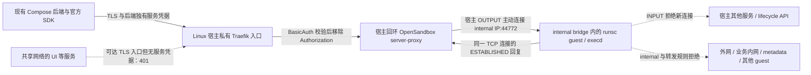

# 技能脚本执行：Linux Docker + OpenSandbox + gVisor 接入设计

> Design Basis: **Independent Architecture**。
> Status: **APPROVED / IMPLEMENTATION_READY**。§23 已补独立 WSL profile 的 D-IT1 与真实 init/proc 验证；结论只适用于该环境，业务部署对应门槛仍待核对。用户于 2026-11-15 批准 §21 范围、§22 正式实现及后续有界真实验证。滚动实现/CI/评审见 #1293/PR #1298；不签发产品验收或自动开放试用。
> 日期：2026-11-14；最近独立增量复核：2026-11-15；调查基线：main `cbaadd5efd9bc6ef2f8204550f926929deecf566`。
> 初始授权：按 OpenSandbox + gVisor 设计接入现有技能库、尽量复用 Eino 和工具链，明确“先别改生产代码”。初始设计与独立评审阶段未执行安装/部署；后续获准的独立测试环境安装和 POC 见 §19，生产代码/依赖、真实模型及业务数据仍未改动；作者自检不替代独立评审。
> 正式执行 Issue：[#1293](https://github.com/henryxu1008/shuomi-ai-commerce/issues/1293)，状态唯一来源为 Issue 正文。设计分支 codex/skill-opensandbox-design 只承载前阶段文档；正式实现使用独立 codex/1293-skill-script。
> 当前授权：按批准设计正式实现、必要隔离验证、提交/推送及维护一个主要 PR；先不合并或部署，不操作既有业务实例、真实模型或业务数据。复用独立 WSL 测试 Engine，不改变 Docker Desktop 配置或业务容器。Linux Docker + gVisor 优先，Kubernetes 非前置。§12–21 中“本轮不改生产代码/未接单”等措辞为各阶段历史停止点，由本段及 §22 的后续授权替代。

## 1. 已批准产品决定、用户结果和首版范围

### 已确认的边界

产品决定 **PD-SKILL-SCRIPT-TITLE-V1-2026-11-15**：用户明确批准 §20 的三组最小范围，批准记录与准入映射见 §21，正式执行为 #1293。现有 [Skill V1](skill-capability.md) 的文本合同继续有效；本决定只在本设计的显式新脚本策略、标题消费者和准入下局部解除其脚本 Out of Scope，不授予任意脚本权限，不改变其他消费者或原四模式的一般合同。当前已授权正式实现，尚未开放试用或部署。

首版让现有技能库用户完成一条明确操作：在“我的技能 / 团队技能”保存包含 Python 脚本的准确版本；处理当前企业已保存商品的标题时显式选择它；模型形成标题候选后，脚本做确定性排版或结构转换；用户查看执行状态、处理前后标题和所用版本，再沿原 Review/Catalog 路径人工采用。例子是统一空白和标点、应用明确的标题字段拼接格式，不把脚本计算结果当作品牌、材质、认证等商品事实。

首版限定：**一个选中技能、一个已保存 Python 入口、CPython 标准库、一次候选后处理、JSON 输入/输出、无外网、无业务写入、无额外模型调用**。不新增顶层菜单、通用终端或独立脚本工作台。技能详情显示入口及运行要求；使用入口继续在原标题流程；任务/建议详情显示真实处理结果或具体失败原因。失败/UNKNOWN 明示并停止，不静默回退或自动重派。只读 GET、导入、格式检查、发布和启用均不执行脚本。

首版开放对象为有效企业内的内部试用用户，沿个人/团队/官方现有权限；个人脚本必须本人可用且经企业准入，无企业可编辑但不能执行。仅在现有 `default`、`read_only` 的标题建议路径开放脚本：`default` 走明确人工采用，`read_only` 只查看；`auto_approve` / `full_access` 对脚本版本明确显示暂未开放，不静默切模式或跳过脚本。这是本次已批准的首版限制，不改其他文本/业务消费者的模式权限，也不是自动永久推广到所有消费者。

### Must / Should / Out of Scope

- **Must**：准确版本与完整摘要绑定；当前身份/企业/准入；真实 gVisor 执行且无 runc 降级；可验证的无外网；有界资源及取消；脚本输入输出可追溯；不冒充商品事实或权限；原模型预算、Run/CAS、审计、Review/Catalog 与人工确认边界；失败不伪成功；同一运行不因响应丢失自动重发脚本。
- **Should**：复用官方 Go SDK、Eino 接口和现 Registry/Store；在技能详情显示运行要求和结果差异；复用现有错误、任务和日志展示。
- **Out of Scope**：任意 Shell/模型现场生成代码、动态安装依赖、多脚本工作流、网络授权、浏览器/桌面、用户自选镜像、长驻会话、跨运行复用可写目录、图片二进制产物、付费模型/API 调用、平台写入、自动调度/恢复平台、独立执行账本、迁移与双读双写。
- **Accepted Risks**：本轮没有新批准的安全风险豁免，D-IT1 剩余项仍是试用开放 Must。脚本业务语义是否合理仍需用户判断；格式检查、沙箱运行成功和结构校验均不表示语义正确或产品验收通过。

依据：[项目边界](project-boundaries.md)、[目标架构](project-target-architecture.md)、[Skill V1](skill-capability.md)、[商品内容](product-content-localization.md)、[Agent Runtime](product-agent-runtime-contract.md)、[Commerce Tool](commerce-tool-foundation.md)、[企业配置](organization-agent-configuration.md)、[四模式](enterprise-agent-permission-modes.md)、[全新系统基线](../product/greenfield-no-legacy-migration.md)、[派工规则](../engineering/issue-driven-development.md)。UI 以用户当前决定和真实路径为准，Figma 只辅助理解业务流程。

## 2. 当前代码证据及必须承认的缺口

| 已核对入口 | 当前行为 | 本次设计含义 |
| --- | --- | --- |
| `internal/skill/package.go`、`package_test.go` | 只收根 SKILL.md、一层 references/assets 文本，明确拒绝 scripts；每文件 16 KiB、包 48 KiB、16 文件 | 需要显式脚本包格式和准确摘要；不能只改上传扩展名 |
| `internal/agent/skill.go` | SkillVersionRef 只认可 `skill-method-v1`；ref 是引用而非授权 | 新脚本策略须显式准入，不能使已有文本 ref 自动获得执行权 |
| `internal/integration/agent/einomodel/skill.go` | 方法作为不可信标题材料读取；系统禁止执行命令 | 脚本执行由代码控制；不要求模型根据 SKILL.md 自行执行 |
| `internal/integration/skillimage/context.go` | 提取固定视觉说明交图片消费者 | 首版不接图片链，不将其外推为代码执行入口 |
| `internal/agent/contracts.go` | Action 无任意工具 Arguments；ToolGateway 只收固定 Binding | 首版不扩为自由命令/自由参数通道，采用服务端固定后处理步骤 |
| `internal/integration/agent/eino/{runtime,steps}.go` | Graph、唯一 Run Claim、原 CAS/checkpoint；Running 不自动恢复 | 复用原状态 owner；新增步骤要进入原 fingerprint/History/Commit，不能旁路运行 |
| `internal/commercetool/{registry,invocation}.go` | 准确 Tool allowlist、实时 principal、schema、超时、摘要审计 | 复用 Registry/BoundToolSet；其 context 超时不是远端进程终止证明 |
| `internal/integration/persistence/agent/read_audit.go` | 调用结束后插入安全审计摘要 | 审计表不是 dispatch claim、执行结果库或原子重试凭证 |
| `internal/app/httpapi/product_content_application.go`、`internal/product/contentagent` | 已有内容专用消费者、模型、validator、Run/Review 装配 | 只给明确注册的标题脚本消费者接线；不扩大所有 Agent 工具能力 |
| `internal/integration/persistence/skill/use.go` | 准确版本、当前企业 activation/个人准入和锁定使用 fence | 沿现有 use gate；导入/复制权限与执行准入仍分开 |
| `deployments/docker/account-compose/docker-compose.yml` 的 current-application/listingkit-ui/traefik | 均为 `network_mode: service:runtime-network`；现有 Traefik v3.6.8 使用 file provider | 同一 IP/loopback 不是后端专用身份；本次复用相同 Traefik 工具的私有实例和内置服务凭据校验，不把现有共享网络整体加入可信调用者 |

关键架构问题是：**现有文本材料、事后审计和固定工具网关，均不能直接承担任意远端代码执行。** 本设计通过固定无外部业务副作用的后处理缩小增量；不把现表改称通用脚本执行平台，也不为了接入 ADK 而重写现有 Run。

## 3. 开源复用与版本依据

### Eino

已从本机模块缓存核对锁定的 **Eino v0.9.21**：`adk/filesystem` 已定义 Backend、Shell、StreamingShell；`adk/middlewares/filesystem` 提供 ADK 文件/执行工具；`adk/middlewares/skill` 的 filesystem backend 按技能名称扫描目录。当前应用实际使用 compose.Graph，并未消费这些 ADK middleware。

复用方案：

1. 保留 Eino Graph 的分支、状态与 checkpoint；脚本后处理是一个固定的可选节点，不新增 Agent Runtime。
2. 集成层使用任务需要的中立 typed execution port，保留 Eino Graph 作为真实消费者；SDK 已支持的 Argv/Cwd/UID/GID/Timeout 原样使用。只有实际 Eino Shell 消费者需要时才适配 `filesystem.Shell`，不强制绕字符串命令，不预建 Backend/六种通用文件操作。
3. 真正执行与文件传输复用 OpenSandbox 官方 Go SDK；不自写 HTTP/SSE 客户端、Python 解释器、容器调度或隔离机制。
4. 不直接启用整个 ADK Skill/FileSystem middleware；其自动工具暴露、按名称加载和当前报价/准确版本合同不等价。以后有真实 ADK 消费者再复用这些 middleware，不在本批迁移。

`eino-ext/adk/backend` 当前官方目录只有 local/agentkit，未发现官方 OpenSandbox Backend。必要适配只连接 Eino 接口与 OpenSandbox SDK，不发布通用多厂商 backend SDK、不实现第二套 ls/grep/路径语言。local 直接操作宿主，agentkit 依赖火山服务，本方案均不采用。

### OpenSandbox 与 gVisor

候选基线是 OpenSandbox **release-1.2.1**（2026-11-13 发布，release commit `db708c2`）；Go SDK module 路径仍为 `github.com/alibaba/OpenSandbox/sdks/sandbox/go`。已核对该 tag 的 SDK README/go.mod、Docker runtime、server-proxy 配置/路由及 SDK 接入源码；最低 Go 1.20，项目为 Go 1.26。2026-11-15 在独立非正式 POC module 中已解析/编译官方 **v1.2.1**，原始 source commit 为 `db708c218771a8d311356f0e96552c15df6e097a`，模块校验和 `h1:oikjPivbXj/9MenqLRhNUU6+1TeWHa6RuXz4QodLoeo=`，HTTP 替身边界测试及 §19 的真实联合控制链均已通过，生产模块未引入依赖。准确镜像 ID、Linux Engine/runsc 与宿主规则范围见 §19；正式部署须核对对应组合，不用 `@latest`。本版不用 egress sidecar、ingress gateway 或 Cilium，POC 证据不外推为任意部署已验证。

后续真实 POC（§19）锁定 Server/SDK **1.2.1**，execd 使用同版官方 `opensandbox/execd:release-1.2.1`，amd64 manifest `sha256:08bf71fda668282fd4a51ac38528eb571a42a03a2b67cca542d539b4280bd39c`，实际 config ID `sha256:60fc3b394c1e6f94e27cd0cb831e9fae5d80f232e7775313e79b6160f5b8aeec`；POC server 最终配置使用该不可变 ID。**不得照抄上游旧示例的 execd:v1.1.0**：真实请求已证明它不支持本设计的原生 argv，不能用 Shell fallback 补通。Python 实际 config ID `sha256:78976a69c067520ef8be34cde307ef9f6fea6dcefa50edb57039773d241ca0db`；实际 Engine/runsc/XFS/Traefik 组合及证据边界见 §19，不外推为任意部署均可用。

当前修订选择 **Linux Docker Engine + OpenSandbox Docker runtime + runsc/gVisor + 专用 internal bridge + 宿主 Netfilter**。固定 `runtime.type=docker`、`secure_runtime.type=gvisor`、`docker_runtime=runsc`、`docker.network_mode=<预先建立的专用网络名>`，不使用默认 docker0 或 host 网络。gVisor 是用户态内核隔离，不是硬件虚拟机；受信部署核对 Engine runtime 配置和实际容器 HostConfig.Runtime，不采信脚本/dmesg 自报，也不声明 Windows Docker Desktop/WSL 已满足。

R1 的上游拒绝事实仍成立，创建请求不传 OpenSandbox `networkPolicy`。锁定版 Docker runtime 支持预先存在的用户自定义网络；网络/容器隔离由 Docker 和宿主防火墙负责，规则在 gVisor 外执行，不要求 guest 内支持 nftables。仅删除 API 字段不满足 Must：§8 的 internal/宿主/同网隔离、DNS 与控制通路必须作为同一固定部署 profile 核对。

关键控制通路结论：**仅接 internal 网络的容器不能依赖 published ports**，不能简单照抄默认 host-mapped endpoint，也不能为打通端口附加第二张外联网。首版候选复用 SDK `UseServerProxy=true` 和服务端 `[proxy] resolve_internal=true`；OpenSandbox server 运行在该 Linux 宿主的主机网络命名空间，由其从准确 sandbox ID 解析 internal IP 并访问 execd。这个第三方现成路径只适用于当前受限功能，不另写网关/代理或改 SDK endpoint 解析。§8 说明认证、凭据过滤和宿主边界。

独立增量评审已纠正认证假设：锁定版单租户 proxy 路由跳过 lifecycle API Key 校验，SDK 携带 Key 不等于该路由已认证；当前 Docker profile 又不支持 secureAccess。§8.3 已将入口收敛为复用 Traefik 内置 BasicAuth + TLS、原始服务仅监听宿主回环、宿主规则限制可达范围；同网络命名空间的其他服务凭据缺失时仍不得使用。该项按 §15 的 IMPLEMENTATION_TEST 收敛，不新增认证平台或自动切换多租户 owner。

上游状态限制：server-proxy 已于锁定版进入 **deprecated / maintenance mode**，仍保留安全和 bug 修复，不新增特性。本设计在已批准受限首版中选用现有受维护 API，不冒充其为上游长期推荐路线；§19 已验证准确组合，§20 独立复核和 §21 产品/任务准入已完成，不新增安全风险豁免。若后续版本功能/安全维护不能满足当前 Must，先报告，不自行维护 fork、写代理、加外联网或要求用户转 Kubernetes。实际部署的 D-IT1 缺项仍须在试用开放前完成。

复用成熟能力而不建平台：Docker 原生 internal bridge、ICC/宿主 iptables/conntrack、OpenSandbox 已有代理/SDK 和原应用 Run/工具链。当前候选使用 Docker 成熟的 **iptables backend**（可由发行版 iptables-nft 前端实现），不为本功能切换 Docker 的实验性 native nftables backend，也不关闭 Docker 自有规则。保留现有 Account Compose 服务/身份/数据库，不给主应用 Docker socket；仅专用 OpenSandbox 控制面具有 Docker 管理权。主应用无需迁移到 Kubernetes，也不部署 Cilium/新 CRD/控制器。

官方依据（均为资料核对，非本机运行证据）：

- [Eino Backend/Shell](https://www.cloudwego.io/docs/eino/core_modules/eino_adk/eino_adk_chatmodelagentmiddleware/filesystem_backend/)；[锁定版接口源码](https://github.com/cloudwego/eino/blob/v0.9.21/adk/filesystem/backend.go)；[官方 backend 目录](https://github.com/cloudwego/eino-ext/tree/main/adk/backend)。
- [OpenSandbox release](https://github.com/opensandbox-group/OpenSandbox/releases/tag/release-1.2.1)；[该版 Go SDK](https://github.com/opensandbox-group/OpenSandbox/blob/release-1.2.1/sdks/sandbox/go/README.md)；[SDK go.mod](https://github.com/opensandbox-group/OpenSandbox/blob/release-1.2.1/sdks/sandbox/go/go.mod)。
- [该版服务配置](https://github.com/opensandbox-group/OpenSandbox/blob/release-1.2.1/server/configuration.md)；[安全运行时](https://github.com/opensandbox-group/OpenSandbox/blob/release-1.2.1/docs/guides/secure-container.md)；[egress 设计及降级限制](https://github.com/opensandbox-group/OpenSandbox/blob/release-1.2.1/oseps/0001-fqdn-based-egress-control.md)。
- [gVisor 安全模型](https://gvisor.dev/docs/architecture_guide/security/)；[Docker 接入及 runtime 核验限制](https://gvisor.dev/docs/user_guide/quick_start/docker/)。
- [Docker internal 网络的宿主/网关边界](https://docs.docker.com/reference/cli/docker/network/create/#network-internal-mode---internal)、[bridge/ICC 选项](https://docs.docker.com/engine/network/drivers/bridge/)、[DOCKER-USER 与转发链](https://docs.docker.com/engine/network/firewall-iptables/)、[native nftables backend 状态](https://docs.docker.com/engine/network/firewall-nftables/)。
- [internal-only published ports 的 Moby 维护者说明](https://github.com/moby/moby/discussions/53256)、[Docker 端口/isolated gateway 边界](https://docs.docker.com/engine/network/port-publishing/)、[internal DNS 修复](https://docs.docker.com/engine/release-notes/26.0/)、[Moby v28.5.2 resolver 依据](https://github.com/moby/moby/blob/v28.5.2/libnetwork/sandbox_dns_unix.go)。
- [锁定版 Docker endpoint/网络校验](https://github.com/opensandbox-group/OpenSandbox/blob/release-1.2.1/server/opensandbox_server/services/docker/networking.py)、[容器限制与 runtime](https://github.com/opensandbox-group/OpenSandbox/blob/release-1.2.1/server/opensandbox_server/services/docker/container_ops.py)、[server-proxy 认证头过滤/流式转发](https://github.com/opensandbox-group/OpenSandbox/blob/release-1.2.1/server/opensandbox_server/api/proxy.py)。
- [SDK HTTPClient/UseServerProxy 及维护状态](https://github.com/opensandbox-group/OpenSandbox/blob/release-1.2.1/sdks/sandbox/go/config.go)、[SDK 代理 endpoint 与 API Key 接线](https://github.com/opensandbox-group/OpenSandbox/blob/release-1.2.1/sdks/sandbox/go/sandbox.go)、[Docker diagnostics 的实际证据范围](https://github.com/opensandbox-group/OpenSandbox/blob/release-1.2.1/server/opensandbox_server/services/docker/docker_diagnostics.py)。
- [单租户 proxy 的 API Key 豁免](https://github.com/opensandbox-group/OpenSandbox/blob/release-1.2.1/server/opensandbox_server/middleware/auth.py)、[proxy 访问续期总开关](https://github.com/opensandbox-group/OpenSandbox/blob/release-1.2.1/server/opensandbox_server/integrations/renew_intent/proxy_renew.py)。
- [Compose network_mode 的共享及 networks 互斥规则](https://docs.docker.com/reference/compose-file/services/#network_mode)、[Traefik v3.6 内置 BasicAuth/usersFile/removeHeader](https://doc.traefik.io/traefik/v3.6/reference/routing-configuration/http/middlewares/basicauth/)、[v3.6.8 实际认证源码](https://github.com/traefik/traefik/blob/v3.6.8/pkg/middlewares/auth/basic_auth.go)、[entryPoint 默认 middleware/TLS](https://doc.traefik.io/traefik/v3.6/reference/install-configuration/entrypoints/)、[HTTP 流式转发](https://doc.traefik.io/traefik/v3.6/reference/routing-configuration/http/load-balancing/service/)。

## 4. Owner、合同与注入

| Contract → implementation → injection → consumer | 唯一责任与边界 |
| --- | --- |
| 脚本包/准确版本 → `internal/skill` + 原 skill persistence → 原 RunDB/Skill service → 管理页、使用准入 | 版本、正文、脚本、manifest 和复制来源的唯一 owner；不持有 OpenSandbox 凭据 |
| 标题后处理业务合同 → `internal/product/contentagent` 的窄 policy → 原 content application 装配 → 新准入的标题脚本消费者 | 冻结标题输入、允许修改字段及候选语义；不直接调用 SDK/DB |
| `skill.script.compute@v1.0.0`（候选 ID）→ 原 Commerce Registry/Executor → 原 BoundToolSet/Principal/Authorizer/Audit → 固定后处理节点 | RiskCompute、无业务/平台 mutation、无 AIInvocationID；不动态注册每份脚本为 Tool |
| 中立 execution port → `internal/integration/skillsandbox`（拟新增薄适配）→ app composition 注入官方 SDK → 上述 Executor/Eino 固定节点 | 第三方 DTO、固定 argv、上传/收集、取消和清理；业务授权不落入 SDK adapter；不为形式多包一层 Shell |
| 固定网络部署合同 → Docker internal bridge/ICC + 宿主 Netfilter + 上游 server-proxy → 获准 Linux 宿主 → 原 SDK adapter | 受信部署 owner 持有 runtime/固定网络与规则；应用只用受信配置及原 sandbox info 关联准确实例，不写规则、不获 Docker socket、不新建证明 API/控制器 |
| 后端专用入口 → 同版 Traefik 私有实例的 BasicAuth/TLS + server 宿主回环绑定 → 原私密文件/只读挂载及 SDK Headers/HTTPClient → 固定 adapter | 部署 owner 管理服务间凭据/入口，后端不持有用户认证的替代权；只区分受信进程调用者，企业/用户授权仍由原 principal/use gate 持有 |
| 原 Run Claim/Commit/History → 原 agent Store/guard → 原 RunDB → Graph、任务详情、Review provenance | 同一 run owner 保存控制和结果；无 script_runs 表或第二恢复调度器 |
| 容器 lifecycle/到期回收 → OpenSandbox → 专用 worker → adapter | 临时基础设施状态；不是业务成功、授权或 Catalog 的第二事实源 |
| 最终候选 → 原 content validator/Review → 原采用服务 → Catalog | 只有原采用入口可以修改商品；脚本、模型和沙箱均不能授权采用 |

新增中立 port 用任务需要的 typed 值表达一次计算：准确 Skill ref、冻结执行描述、输入 bytes/hash、RunID/CallID/Deadline；结果为有界 JSON、退出/超时类别及摘要。SDK endpoint/token、Eino filesystem DTO 不进入 Product/Skill 公共合同。app 只装配，不积累执行 policy。

## 5. 技能包、运行 profile 与权限

首版沿用完整 JSON 文件列表与不可变宿主版本，不接 zip/tar、URL 下载或模型临时写入代码：

```text
SKILL.md
execution.json
scripts/normalize-title.py
references/rules.md                 # 可选
```

`execution.json` 是新格式，建议固定如下；解析用现 JSON 严格解码/schema，拒绝未知字段。仅放文件不授予执行权。

```json
{
  "schemaVersion": "skill-script-v1",
  "profile": "python-title-json-v1",
  "entrypoint": "scripts/normalize-title.py",
  "phase": "title-candidate-postprocess",
  "inputContract": "title-candidate-v1",
  "outputContract": "title-result-v1"
}
```

- 脚本包必须有明确的 `product-title` 方法标记和新代码策略 `skill-script-method-v1`；SkillVersionRef 的新增策略及脚本消费者版本要一并准入。原 `skill-method-v1` 文本包继续只解释为文本，不能因 assets 中已有 JSON 或 SKILL.md 中有代码块而触发执行。无需迁移、回填或生成第二份版本事实。
- 完整 canonical digest 覆盖全部文件及 manifest；冻结执行描述另绑定 manifest/入口摘要、profile revision、实际镜像 digest、工具版本、输入合同及外层 network profile/revision。不接受 latest、客户端镜像、额外 Shell 参数、网络标签/策略或客户端 sandbox ID/endpoint。
- 首版仍用最多 16 文件、每文件 16 KiB、包 48 KiB、请求 96 KiB；只增加上述 root manifest 和一层 `scripts/*.py`。入口必须为包内准确文件，所有包内 Python 文件计入 digest；沿现路径/大小写冲突/UTF-8/引用限制，不解压、跟随链接或访问宿主路径。
- profile 由部署配置声明固定 CPython 镜像与标准库；不提供 pip、npm 或运行期下载安装。镜像与初始依赖由安装 owner 预备；SDK API Key 仅由服务端私密配置持有，不进入技能、浏览器、模型或 guest 的业务环境变量。
- 继续复用个人/组织/平台的 read/edit/publish/copy/consent，执行只在当前有效企业内。个人技能必须本人可用且企业明确准入，团队技能沿当前组织 use 权限；无企业仍可编辑，不能执行。发布/复制许可不代表脚本运行许可。
- 脚本开放通过本次明确注册的消费者版本、服务端固定 profile、现企业 Agent 准入和用户本次准确选择共同决定。现 allow_personal/default/full_access 均不单独授予代码执行权；配置或策略缺失 fail closed，不新建 IAM/权限管理平台。
- prepare/Claim 前读取准确包并冻结 descriptor；脚本派发前与结果/Review 使用前分别复验 live identity、org/member、Agent activation、Skill use、模式与 descriptor。沿原 fence 使用，调用有硬超时；撤销后不得启动新动作。已进入执行的在途任务可能完成，结果仍须通过当前门槛，不承诺瞬间远程撤销。

模型材料只包含已批准的 SKILL.md/参考说明及声明性执行摘要，**脚本源码和 runtime manifest 不作为模型可执行指令注入**。prepare、Quote、Decide 对相同材料投影保持一致，代码不因执行后结果进入而偷偷增加模型调用。该投影是显式新策略，不改变文本包原有输入合同。

## 6. 固定调用链及结果责任

在新准入消费者的 Eino Graph 中加入固定的候选后处理节点：

```text
原执行确认 / 准确 Skill 选择
  -> 原配置/报价/模式 + 执行 descriptor 冻结
  -> 原 Run 唯一 Claim
  -> 原事实读取 / governed model -> title Candidate
  -> 固定 script compute 节点（仅选中脚本版本时、一次）
  -> 原 candidate validator -> 原 Run CAS Commit
  -> 原 Review 展示差异 / 明确采用 -> Catalog
```

后处理节点由代码路由，不由模型输出任意 Arguments、命令或循环节点名。模型仅选择原有工具；新 compute Tool 的调用由固定节点使用原 BoundToolSet，不能作为一个自由 Shell 工具加给所有 Agent。现 Action/ToolGateway 不必增加任意参数协议，新增内部 typed port 用于固定节点与 Executor；节点仍计入原 Steps、deadline、History 和审计，不能在 GovernedModel/Validator 内藏执行。

消费者运行定义可以包含内部 compute Tool，但传给 governed model 的可选工具投影必须仍为代码声明的原事实工具子集；模型 action 校验明确拒绝请求该内部 compute Tool，不能仅靠提示词“不调用”。当前装配直接把 `definition.AllowedTools` 交给模型，实施须在此处做有界分离并测试，不能注册新工具后意外对模型开放它。内部固定节点和模型 action 路由须可区分，均沿相同 Registry/principal/audit 合同。

当模型 interrupt、候选缺标题、原预算不足或授权失败时不执行。每个 Run 最多一次；不得利用 repair 循环重跑、在 resume 时补跑或复用旧脚本结果处理新候选。首版脚本产物未通过结构/领域校验则停止并显示具体错误；用户改变脚本或输入后明确发起新运行。脚本之后不自动加一次模型修复；既有模型调用硬预算不提高。

输入仅投影本次 title Candidate、目标语言、原候选的有界来源引用及必要的固定格式参数；不上传整个商品库、聊天历史、Skill 私有旁支、知识库、cookie、平台身份或文件路径。执行描述与输入哈希在派发前固定。脚本只能返回一个标题字符串与有界诊断，不返回可供宿主执行的命令、路径、URL 或权限字段。

首版 guest 协议固定为 `/workspace/input/input.json` 输入和 `/workspace/output/result.json` 输出，均使用 UTF-8 JSON。输入形状为 `{"schemaVersion":"title-candidate-v1","title":"原候选标题","targetLanguage":"en","evidenceRefs":["原候选已获授权的引用"]}`；`evidenceRefs` 只读且可为空，不把 ID 存在当作模型已观察事实。输出形状为 `{"schemaVersion":"title-result-v1","title":"处理后标题","diagnostics":[]}`。标题必须非空且符合原字段上限，diagnostics 最多 8 个、每个最多 256 UTF-8 bytes；两种文档均拒绝未知字段、重复键及非 JSON 值。固定 phase/format 由已保存脚本实现，本版没有浏览器自由传参。schemaVersion、格式和有界数值复用现 JSON Schema/严格解码能力校验；不根据 diagnostics 自动批准或清除待确认项。

adapter 先完成 §8 的受信网络 profile/准确 sandbox 身份检查，再通过 SDK 上传到该任务独立目录。调用使用锁定 SDK 的 `RunCommandRequest.Argv` 传固定 CPython 可执行文件和准确包内入口，设置固定 Cwd、非特权 UID/GID、非零 Timeout（毫秒），`Command` 留空、`Background=false`。业务文本仅经 JSON 文件传递；不转成 Shell 字符串，不给 SDK 默认零超时。输入/包目录只读、输出临时目录可写的具体配置须在兼容验证中确认，不能把上传后文件权限自报当作隔离证据。

结果从固定输出文件读取；stdout/stderr 是诊断而非协议，也不自动送模型。只有退出完成、完整有界输出、原输入/版本匹配、结构校验和审计全部确认，结果才可参与候选校验。超限明确失败，不截断为合法标题；只收固定普通文件，拒绝 symlink/设备/FIFO/包外路径，不通过 returned path 去读宿主文件。

R1-IT2 的终态合同明确如下：只有收到本次前台命令的初始化身份及可信 `execution_complete`、该事件明确 `exit_code=0`、无任何 execution error，且完整输出/校验/审计通过，才能返回成功。SDK 高层为了兼容旧响应而推断的 `Execution.ExitCode=0`、函数 `err=nil`、文件存在、普通 EOF 均不充分；本方案锁定版本，不采用缺少 wire 退出码的兼容成功判定。终态缺失/冲突、init/stdout 后 EOF、断流或无法确认已停止一律保留 `outcome_unknown`；可信 error 事件带非零退出码则为已知 `script_failed`。若后端明确证明未派发才可标记 `not_dispatched`，不能从错误字符串猜测；本版各失败均停止，不自动重试。

执行的 outcome 与清理状态分开：`succeeded | failed | outcome_unknown | not_dispatched` 加有界原因；cleanup 为 `not_needed | completed | pending`。这些是原 Run 中的 typed receipt 字段，不是新运行状态机/恢复账本。未知、输出超限、审计失败和取消都不能因 cleanup_completed 改为成功；明确进程失败不能被 cleanup_pending 改称“可能成功”。

计算结果不新增来源证据；原 Candidate 的来源/引用/商品绑定由服务端保留，脚本无权重写。现 validator 检查字段选择、长度、结构、来源存在性及当前确定性规则；**不追加语义正则、关键词枚举或第二模型互验来证明自由文本业务事实**。无法确定的事实交用户确认，运行成功不能消除原 unresolved。UI 展示处理前后标题，采用哈希绑定最终标题及准确执行 provenance。

## 7. 持久化、幂等、UNKNOWN 与恢复

### 原 owner 内最小扩展

不新建 schema、script_runs、通用队列或执行账本。拟在原 Request/配置快照与 fingerprint 中增加有界 execution descriptor，在原 State 中保存原始候选标题、脚本处理标记/安全 receipt 和最终候选；History 保存 compute Tool 的有界结果/摘要。原 Review provenance 必须绑定最终 candidate hash、准确 Skill ref、执行 descriptor/hash 和原 Run，不仅依靠 UI 标签。具体 codec/快照字段是正式实施 diff，不能宣称当前已有。

dispatch identity 为原 `org/actor/member + RunID + 原 revision + 固定阶段 + CallID`，payload digest 覆盖冻结 Skill/manifest/镜像/profile/输入。相同请求键与不同 descriptor 冲突；同键已完成仅按当前读权限回显原结果，不重新创建 sandbox。每个获唯一 Claim 的 run 只进入一次节点。原 CAS 保存控制、候选和结果；审计只存既有安全摘要，不存源码、完整输入/日志、token 或 endpoint。

本版不提供结果丢失后的自动恢复或继续执行：原 Store 中的 Running 已禁止重新 Claim，足以阻止进程重启/重放该 run 时再次派发。沙箱命令开始前不伪造“审计已记录”，结束后不把审计回执当作运行结果提交成功。若 future requirement 必须恢复 Running 或跨重启取回脚本结果，需要另行扩展原 owner 的持久派发合同；不能拿本设计当授权。

### 失败行为

| 位置/事件 | 可确认事实与本版动作 |
| --- | --- |
| prepare/授权/profile/gVisor/网络准入失败 | 不运行脚本；未具备已核对的 Docker 网络 profile/准确 sandbox 身份就不上传私有输入；已有模型费用沿原账本保留；不切无技能/新 profile |
| Run Claim 失败、未确认或已有 Running | 不创建沙箱，不派发；读取原记录；不可从客户端重试推断未执行 |
| 创建 sandbox 响应丢失 | 不盲重试 create；按预先设定的 TTL 由 OpenSandbox 到期回收；可能产生未取回 ID 的短期实例，运行显示执行结果未确认 |
| 上传响应丢失/任一步控制面失败 | 停止，不进入命令派发；已知 sandbox 做有界清理，未知 ID 由 TTL 回收；不把残缺上传作成功 |
| 命令已发出、SSE 断开或超时，含无完成事件的正常 EOF | 不重新 POST 命令；归为 outcome_unknown，不进入 Review；请求 interrupt/删除本次 sandbox，不能把断开或 SDK nil error 等同于完成 |
| 明确非零退出，或明确完成但输出缺失/越界/非法 | 已知 script_failed/output_invalid；保留安全诊断；不采用原候选冒充脚本成功；未收到终态时不能仅凭结果文件改称已知完成 |
| 取消、身份/企业/模式/技能失效 | 阻止后续动作与采用，向本次远端执行发停止/清理；在途结束与否分别记录 |
| 审计失败 | 沿原 audit_unavailable 停止；不重跑脚本补审计 |
| 原 Run Commit 失败/ACK 丢失 | 不返回可采用成功；查询同一 Run 确认 CAS 结果，仍未知则保留未知；审计存在不能替代 Commit |
| 服务崩溃后原 Run 仍 Running | 原 run 不自动 resume/re-dispatch；UI 显示原运行结果未确认，任务隔离资源由有限 TTL 回收 |
| 结果提交成功但临时资源删除失败 | 已提交结果与 cleanup 状态分开；不重跑；留诊断并由 OpenSandbox 到期回收，不新增恢复服务 |

OpenSandbox SDK 的创建/命令 POST 不开启可产生重复执行的自动重试；优先显式关闭该路径自动 retry/wake resend。官方 SDK 若默认做可证明 pre-send 的重试，仍须核对锁定版本及 deadline，不把它描述为 exactly-once。GET/同一实例删除等可安全重复操作仅做有界重试，不增加执行身份。

语义是“**同一已 Claim Run 不自动重派，未知就停止**”，不是分布式 exactly-once 保证。用户对无业务副作用的失败/未知运行可以显式创建新 Run，但必须显示旧运行可能已执行，不自动复制旧的已发生模型费用或重置预算事实。

## 8. 威胁模型与部署边界

Threat Model 覆盖恶意/错误技能、模型与浏览器伪造参数、跨企业读取、资源耗尽、SDK 响应丢失，以及脚本试图访问宿主、内网或执行外部副作用。受信范围是应用后端/授权 owner、OpenSandbox 控制面、宿主管理员及固定运行 profile；不引入“抵抗已被攻陷的宿主管理员”这一额外目标。gVisor 不代替应用权限和网络策略。

### 8.1 Linux Docker 固定部署 profile

这是文档合同，不是已执行的宿主操作。首版使用获准的单台 Linux Docker Engine，OpenSandbox server 作为受信宿主服务运行、只监听宿主 `127.0.0.1:<S>`，可直达其 guest bridge；不把业务脚本设为 host network。现有 Account Compose 后端保留共享网络，通过宿主应用侧 bridge 地址上的私有 TLS 入口 `<M>:<P>` 访问同版 Traefik，再由它访问回环 server。此入口尚不存在；§8.3 明确其最小部署与验证，不能把原文“已有受信管理链路”当作现场事实。首版固定同宿主，不开放跨主机直连；不借此修改原业务/身份端口、数据库或公网入口。

预先建立一个专用用户自定义 bridge：`Internal=true`、`enable_icc=false`、固定网络 ID/bridge 名/子网、IPv4-only。每个 guest 仅连接这一张网络，不附加默认桥、业务网络、macvlan/ipvlan/overlay；不采用 host/pasta/slirp4netns。保留正常 bridge 网关供宿主控制访问，不使用取消宿主 bridge 地址的 `gateway_mode=isolated`。地址与网段由部署 owner 避免和现有业务/管理网络重叠，文档不编造当前实际地址。

Docker 版本不能只按版本号推断安全性：资料核对使用 Moby v28.5.2 路径，实际采用仍受维护且包含 internal DNS 外泄修复及 localhost 端口隔离修复的补丁版本，最低功能基线为 Engine 28。核对发行版 backport/Engine API 与 OpenSandbox/runsc 的准确组合后再锁定，不在本轮升级宿主。只连 internal 网络时 Docker 内置 resolver 不应代理外部 DNS；这个条件与“仅有一张 internal 网络”一并核对，不能只测直接 DNS IP。IPv6 网络不启用，但 loopback IPv6 不代表外联能力；宿主 IPv6 对 guest bridge 的拒绝规则和实际 gVisor 地址/路由仍要检查。

固定 server 配置选择该网络名、runsc、no-new-privileges、必要 cap drop/PID/CPU/memory/磁盘限制；镜像入口只启动锁定 execd。guest 不获 NET_ADMIN/NET_RAW、Docker socket、宿主目录/业务卷/共享 home、server API Key 或业务凭据；无 root 业务脚本、任意 entrypoint/网络/挂载/host namespace 覆盖。SDK 和用户请求不能改变这些配置。Docker 管理权仅在受信 OpenSandbox 控制面，不交给主应用或模型。

### 8.2 宿主网络边界与规则生命周期

优先复用宿主已有的 Netfilter 配置管理和服务管理器，安装 owner 维护只针对这个 bridge/interface/子网的固定规则；不改变全机默认策略、不 flush Docker/业务链、不加 packet proxy 或防火墙 daemon。当前选择 Docker iptables backend：转发规则在官方 `DOCKER-USER` 接入点先于 Docker accept 规则执行，访问宿主服务另外经过 `INPUT`；来自宿主的控制连接经过本机 `OUTPUT`，不能误称所有流量都经过 DOCKER-USER。若实际宿主使用其他 backend，本 profile 不自动套用这些链名，先核对成熟等价配置而非自动迁移。

| 边界 | 首版规则合同 |
| --- | --- |
| guest → 外网/业务内网/metadata | internal 网络无外部默认路由且有 Docker 外部隔离；宿主 FORWARD/DOCKER-USER 对来自 guest bridge 的新连接再拒绝，不能因源 IP 伪装跳过接口匹配 |
| guest → 宿主（含 bridge 网关） | 宿主 INPUT 对来自 guest bridge 的新连接拒绝，覆盖所有宿主地址/端口；仅保留已由受信宿主控制进程建立的 TCP 控制连接回复。不能用“internal 已断网”代替 INPUT |
| guest → 其他 guest | `enable_icc=false` 与同桥转发拒绝共同约束；安装时核对 bridge netfilter 路径/同网互访实际阻断，不能只靠不同容器名或不同 RunID |
| 非受信来源 → guest | 不靠 published ports 暴露服务；转发入 guest 默认拒绝。宿主本地管理员属于既定受信边界，不能把 host 能直接到 internal IP 说成外部租户已有授权 |
| 受信 server → 本次 guest execd | server 在宿主网络命名空间经内部 IP:44772 主动连接；仅该固定目的端口/当前任务的准确地址可用于 SDK 计算。guest 的响应按该连接的 ESTABLISHED 状态返回，不给它主动连接 server/lifecycle/宿主的许可 |
| DNS / IPv6 / 绕行 | 不允许第二张外联网或额外 DNS/代理；核对 Docker resolver 对 internal-only 的外部转发已关闭，直接 IP/UDP/DoH 与 IPv6 也不得外发。镜像下载由宿主完成，不给 guest 开例外 |

规则优先处理准确控制连接的状态回复，再拒绝新连接；不宽放“任意已有连接/RELATED”或整个管理网段。出站拒绝及 INPUT 规则按 guest 入接口绑定，不能只信来源地址。宿主控制进程只在可信边界内运行；若部署者需要对已攻陷的宿主进程做隔离，属于当前 Threat Model 之外的新目标，不能靠本设计伪承诺。

受信安装过程先准备网络和固定规则，再允许 OpenSandbox/脚本 profile 开放；失败保持 profile 不可用。规则由宿主现有持久化方式保存，修改只限本任务链，不每个 Run 动态写规则。Docker/主机/防火墙重启或升级必须停用新脚本准入，复用现有服务依赖/配置核对恢复顺序；未核对同桥、INPUT、IPv6 与 resolver 规则恢复前不得重新开放。不得在有脚本运行时卸载这些防护再靠应用层检查补救。受信管理员修改/重建网络或规则前先按当前资源 owner 处理在途任务；不增加常驻修复 controller。

### 8.3 现成 server-proxy 控制通路与可信证据

首版候选控制链固定为：**原后端/SDK → 私有 TLS + Traefik 内置 BasicAuth → 宿主回环 OpenSandbox server-proxy → 准确 internal IP:44772 的 execd**。lifecycle API 配置 API Key，但锁定版单租户 proxy 路由不校验此 Key；调用者身份由外层现成 BasicAuth 区分，不把共享 IP 当后端身份。SDK `ConnectionConfig.UseServerProxy=true`，server `[proxy] resolve_internal=true`；server 保持受信 Linux 宿主服务，可达指定 guest bridge，不能默默回退到映射端口。具体访问控制及验证见下列四小节；本轮只写设计，没有配置实际入口。



锁定源码支持这一接线：Docker `get_endpoint(resolve_internal=True)` 通过准确 sandbox 容器和命名网络返回内部地址；SDK UseServerProxy 分支携带 lifecycle API Key，但单租户 AuthMiddleware 对 proxy 豁免校验。上游 proxy 过滤 Key/Authorization/Cookie 等敏感头，流式转发并释放 backend response；头过滤是凭据保护，不是认证。SDK 不连接默认 host-mapped URL，也不给 guest 增加外联网。Docker 不使用 secureAccess/Kubernetes gateway；原 principal/use gate/Run 持有业务授权，Traefik 仅保护服务间入口，不能代替租户/用户权限。

维护模式是实质运行限制：server-proxy 只接收安全/bug 修复，未来若所需能力不被锁定版本支持，本方案应返回 unavailable 并报告，不 fork 或自动切到 Kubernetes、第二网络/自建网关。将这条现成受维护 API 作为受限首版候选不等于用户已接受任何新风险，也不授权真实开放。后续正式设计准入须同时确认该限制及源码/运行证据，不隐藏它。

代理只允许 adapter 使用本次已授权 sandbox ID 的 execd 端口和必要 ping、命令、文件接口；端点不来自浏览器或脚本。主应用只持有自身服务凭据及 lifecycle Key；密钥与原始输入不写日志。所有应用调用必须经过外层入口，原始服务端口不发布；不提供通用产品代理入口或签名 URL。单租户 OpenSandbox 原始 proxy 不以缺 Key 返回 401 为预期；外层 Traefik 缺少/错误服务凭据返回 401 是本次新增的可验证边界。

可信证据分层：安装 owner 使用现成 Docker inspect/network inspect、宿主防火墙读取工具核对网络 ID/Internal/ICC/IPv6、runsc、单网络绑定、服务监听/INPUT/FORWARD 规则和 resolver 行为，绑定准确 Engine/profile 版本。应用保存受信配置的 network profile revision，并读取 OpenSandbox 原 sandbox info/diagnostics 的准确 container ID/状态关联本次 Run；这些原 API 不能提供完整 Docker Runtime/防火墙证明，文档不假装已存在该能力。server 的固定配置与宿主规则持续执行部署合同，SDK health 成功或一段诊断文本不能代替现场网络验证。

不向主应用添加 Docker socket/SSH/root 凭据，不为每次执行建立一个新的宿主证明 API 或后台探测服务。任务开始时配置缺失/profile 版本不匹配、server 不可达或资源身份不符均拒绝；宿主配置变更只能由受信 owner 在停止新准入后完成。每次只读业务校验不承担监控/抵抗已被攻陷的宿主管理员的职责。§19 已在准确 POC 组合实测控制链和 guest 对照隔离；只对该证据范围记录通过，不外推为任意生产环境已验证。

#### 8.3.1 具体入口与最小部署范围

当前源码的 `current-application`、`listingkit-ui`、`traefik` 以及若干业务服务共享 `network_mode: service:runtime-network`；因此同 bridge、同源 IP 甚至 localhost 均不能只授权后端。也不能给 current-application 直接追加 `networks`：Compose 禁止与 network_mode 并用，且拆共享命名空间会影响现有 loopback 依赖，超出本任务。现有公网 Traefik 位于该共享命名空间，不能直达 Linux 宿主的 loopback server。

固定最小选择是**复用仓库已用的 Traefik v3.6.8 工具与 file-provider 配置方式，在沙箱 Linux 宿主增加一个独立私有实例**（后续锁定合格补丁/digest），使用原生宿主网络；只做单一后端转发和内置 BasicAuth/TLS，不写代理代码，不启用插件/ForwardAuth/OIDC、用户目录、认证数据库或新的凭据管理服务。它是受信控制面，不能与 guest 共享网络/挂载，不获得 Docker socket。此新增实例和少量静态文件是填补当前真实鉴权缺口的最小运行成本，不能声称原实例已经提供该能力；本轮不建立它，也不改现有公网 Traefik。

部署 owner 使用下列准确参数形成一个受信 profile，先用现成 inspect/监听与规则工具核对，不接受客户端提交值：

| 参数 | 固定含义及约束 |
| --- | --- |
| `B_app / A_app` | 现有 runtime-network 所在 Linux bridge 接口/准确命名空间 IP；不放行整个 CIDR。该 IP 代表共享 namespace，不代表后端身份，容器重建漂移时停止新准入并重新核对 |
| `M / P / N` | M 为该宿主应用侧 bridge 地址，P 为无冲突私有 TLS 端口，N 为映射到 M 的固定控制域名；不得使用 guest bridge 地址或公网地址，不使用 0.0.0.0/:: 监听或自动回退 |
| `S` | OpenSandbox server 唯一原始端口，`server.host=127.0.0.1`；无 IPv6/第二监听、端口发布、DNAT、host-gateway/raw-IP 别名绕行或公网代理路由 |
| TLS / SDK / endpoint | 私有入口仅监听 `M:P`，只接受合格 N 证书；SDK Domain=`N:P`、Protocol=https、UseServerProxy=true。server.eip 显式为 `https://N:P/v1`，返回 proxy endpoint 必须仍属于该 origin 和准确 `/v1/sandboxes/{id}/proxy/44772`，不能返回 raw server/guest 地址 |
| 固定转发 | Traefik 唯一 HTTP 上游为 `http://127.0.0.1:S`，原 `/v1` 路径原样保留，健康读取仅精确 `/health`；router 匹配固定 Host N 与上述路径，只在私有 entryPoint 注册，不启用 TCP passthrough/另一个无鉴权 router；API/dashboard/ping 外部入口和 Docker provider 关闭 |

Traefik 的私有 entryPoint 默认附加 `<sandbox-service-auth>@file`，所有转发 router 都强制 TLS 和该认证；服务凭据文件或 middleware 缺失时，路由不可用，不得生成匿名备用路由。健康状态查询经同一认证路径，原始 health 的公共豁免不构成网络例外。证书、私密文件复用既有获准运维的文件供给/只读挂载与 CA 信任方式；证书必须覆盖 N，实际缺失时保持不可用，不新建 CA 服务或用跳过校验补通。

#### 8.3.2 现成服务凭据与 SDK 接线

- 准备一组本环境后端独有的随机服务凭据（如至少 32 字节随机密码）；用成熟 `htpasswd` 的 bcrypt 格式形成 Traefik `usersFile`，不实现密码校验器。明文只通过独立私密文件只读挂载给 current-application；散列文件只给私有 Traefik，密码不复用用户/数据库/lifecycle Key，不进入镜像、仓库、Compose labels、URL 或前端配置。共享网络服务不自动挂载该文件；宿主管理员及获准配置 owner 继续属于原信任边界。
- SDK 复用 `ConnectionConfig.Headers[Authorization]` 发送 Basic 服务凭据，同时用原 APIKey 字段发送 `OPEN-SANDBOX-API-KEY`。Traefik `basicAuth.removeHeader=true`，不设置 headerField，不把服务密码或已认证用户名传给 OpenSandbox/guest；lifecycle Key 原样交给适用接口校验，再由原 server-proxy 过滤。两组凭据职责分别记录，用户授权不迁入 Traefik。
- 原 HTTPClient/标准 Transport 继续提供解析前限体、TLS 校验和 deadline；固定可信 origin，禁止跨 origin endpoint/重定向，不使用 InsecureSkipVerify，不允许携带服务凭据连接 guest 或默认 mapped endpoint。生命周期与 proxy 请求均走同一外层入口；不改上游 SDK endpoint 算法。
- 此路由不启用 Retry、Buffering、Compress、Failover/Mirroring middleware，单一上游保持 SSE 原始流式转发（responseForwarding.flushInterval 可固定为负值及时 flush），超时不超过本阶段预算；401/503、入口重启或断流不自动重新 POST。命令已派发后认证/清理失败仍按原 UNKNOWN/cleanup_pending 与 TTL 处理，不换 raw URL 或新凭据重发命令。
- 换密复用现有受信文件更新/服务重载流程：先停止新脚本准入，更新散列与后端文件，确保实际进程加载新值后验证旧值拒绝、新值可用再开放。缺少文件、空散列或加载失败均关闭入口。无需新增凭据表、发证服务、轮换平台或定时 controller；已有在途命令按原 deadline/清理处理，不为入口维护解除 guest 网络规则。

#### 8.3.3 两层访问限制及恢复顺序

| 访问方向 | 处理及责任 |
| --- | --- |
| runtime namespace → M:P | 宿主 INPUT 的任务链仅允许 `iif=B_app, src=A_app, dst=M, TCP dport=P` 的准确控制连接；共享 namespace 的实际调用者再由 TLS + BasicAuth 判定，不信任伪造的 Forwarded/X-Forwarded-For |
| 同 namespace 的 UI/其他服务 → M:P | 可达相同 TLS 入口，但无后端服务凭据必须 401 且请求不转发；不能要求这一来源 TCP 不可达，也不能因共享 IP 给它发凭据 |
| guest/其他 bridge/不可信管理网 → M:P | 在 INPUT 按入接口/目的地址先拒绝；不依赖 Key 保密或源 IP 单项判断。只要来源不在实际允许的 namespace，即使知道凭据也不放宽网络 |
| 任意非宿主 namespace → raw server S | server 仅绑定宿主回环，容器的 127.0.0.1 指向自身；宿主 INPUT 对 raw S 仅允许实际回环接口、拒绝其他入接口，包括被路由/DNAT 为回环地址的包，不仅依赖 route_localnet 的默认值。不添加绕行 DNAT/代理，IPv6 无第二入口；外层之外无可调用的 raw server |
| 受信宿主控制面 → raw server/execd | 私有 Traefik 经宿主回环到 server，server 经 OUTPUT 到准确 guestIP:44772；宿主管理员属于既定 trusted。该本地路径不对业务容器开放，guest 回复仍按 §8.2 的准确连接状态返回 |

受信安装先准备密钥/证书/静态文件和仅限本任务的 INPUT 规则，再启动回环 server 与私有 Traefik，完成下列针对性核对后启用脚本 profile。任务链必须在现有宽泛 accept/ESTABLISHED 规则之前生效，不能为了接入修改全机默认策略或 flush 业务链。正常重建造成 B_app/A_app/M 变化时，不自动扩大为整个网段；停用准入、更新准确绑定并核对后恢复。

现有 Linux 服务管理器及宿主防火墙持久化方式负责启动/停止依赖，不建立新网络准入服务。入口、证书、凭据或规则恢复未完成时保持 profile 关闭；防火墙 reload/升级前先停新准入并处理在途任务，不能在运行中先卸载防护。默认不把 restart-policy、/health 成功或旧 profile revision 当作恢复证明。旧允许范围遗留的连接须由既有维护流程关闭后再开放，不额外授予全局 conntrack 清理权限。

#### 8.3.4 针对 D-IT1 的最小验证与关闭条件（§20：POC 子集已验证，部署检查保留）

验证复用现有 Compose 配置检查、Docker/network inspect、ss、宿主规则/计数读取、curl/openssl 与现有 Go adapter 测试；只在获准 Linux 环境使用合成输入，不开发 runner、扫描器或认证验收平台。配置缺失/negative case 使用获准配置副本或既有隔离测试，不在保留实例在线拆防火墙。

| 检查 | 必须看到的结果 / 证据 |
| --- | --- |
| 静态边界 | 有效 Compose 显示共享 namespace 事实；backend 服务密码挂载仅 current-application；私有 Traefik 仅散列/自身 TLS 文件、无 Docker socket；server 仅 127.0.0.1:S，Traefik 仅 M:P，原公网路由未增加沙箱入口；规则按准确接口/地址生效 |
| 合法路径 | 后端凭据 + 正确 lifecycle Key 经 TLS 完成官方 SDK 合成 sandbox 的创建、上传、命令 SSE、有界结果、interrupt/删除；endpoint 返回同一 N:P/v1 origin；guest 无主动出站能力 |
| 同源 IP 的鉴权反例 | 从共享 namespace 的无凭据客户端或既有 UI 容器发无副作用请求：无/错误 Basic、仅有效 lifecycle Key 均由外层 401；用响应及已核对的 BasicAuth 失败不调用下游源码对应，不要求新增转发计量服务。合格 Basic + 错误 lifecycle Key 对受保护 lifecycle 读取应由 OpenSandbox 拒绝，证明两层职责未混淆 |
| 不可信网络与绕行 | 从本次合成 guest、其他业务 bridge 和不可信管理来源核对 M:P/raw S 均不可用，宿主任务拒绝计数对应；UI 同 namespace 可以到 M:P 但只能 401，不能绕到 S。覆盖宿主其他地址、IPv6、已有公网入口，不能靠猜测 sandbox ID 不成功算权限通过 |
| 凭据与 TLS | 正确域名/CA 可用，错误 CA/域名拒绝；无 HTTP 降级。核对 Traefik removeHeader 配置与锁定源码；在既有 adapter/HTTP 测试用合成值证明两组头按用途发送、错误 origin/重定向拒绝、结果/日志不含服务密码或 Key，不以读取真实密钥作为证据 |
| 失效与恢复 | 凭据/middleware/证书缺失使入口不可用；换密后旧值拒绝、新值可用；重启或 namespace IP 变化后未经准确规则核对不得开放。通过既有测试的断流/入口错误验证已派发命令不重 POST，cleanup_pending/TTL 保持 |

部署 owner 记录准确源码/镜像/profile、namespace/IP/监听、规则顺序、脱敏响应/计数及合成 RunID 即可，不新建登记系统。应用侧缺文件/TLS失败/401/端点越界等立即拒绝执行；服务身份不取代每次 Run 的原 principal/use gate。D-IT1 本阶段真实 POC 的验证与正式接入边界见 §19；不把作者文档自检当运行 PASS，也不把 POC 通过写成产品验收。

后续状态以 §20 为准：D-IT1 的入口/实际规则/失效/换密等子集已有 POC 证据，不再将缺 Linux 组合证据作为架构阻塞；本节其余检查仍属 IMPLEMENTATION_TEST，须在相应部署 profile 开放前完成。正式 adapter/principal/Run 消费按获准范围落实，不把 POC 通过写成业务接入或部署验收完成。

首版有界 profile（随 §21 批准范围采用的工程初值，不提高原运行上限或形成长期容量承诺）：

| 项目 | 工程初值 / 责任 |
| --- | --- |
| guest CPU / memory / PID | 1 vCPU / 256 MiB / 64；复用上游 Docker HostConfig 的 nano_cpus/mem_limit/pids_limit，核对实际限制 |
| 命令时间 | 最多 10 秒，且不超过原 Run 剩余 deadline；不够完成则不派发 |
| 整次后处理 | 最多 30 秒（创建、上传、执行、收集）；受原 deadline 更严格限制，不加长原运行 |
| sandbox TTL | 创建时固定 120 秒，关闭服务端 renew_intent 总开关及 auto-wake，不传 renewalPolicy；须核对实际全局配置，不能仅由请求省略字段推断续期关闭，代理访问不能自动延长实例寿命 |
| 输入 / 标题结果 | 输入 JSON 最多 16 KiB；输出 JSON 最多 8 KiB；标题仍受原字段更严格限制 |
| 诊断 / 传输 / 可写空间 | 解码后 stdout+stderr 最多 8 KiB；SSE 原始响应体最多 64 KiB、256 事件；可写层候选改为 **128 MiB**（§19：旧 32 MiB 容纳不了注入的 execd，创建即失败），使用上游 storage_opt size 与合格 storage driver 的实际 quota，不能忽略或改为无限制。空间包含 execd/运行开销，不等于用户输入/产物预算 |
| 并发 | 首试建议最多 2 个活跃 sandbox，由本阶段唯一现有执行进程的有界并发门及 OpenSandbox 原列表/TTL 核对，未知创建/cleanup_pending 也占容量；单进程串行准入后再 create，查询失败拒绝，不伪称 Docker 自带全局 quota；多控制进程/排队/HA 不在本版 |

### 8.4 解析前限额（R1-IT1）

通过 SDK 已有 `ConnectionConfig.HTTPClient / WithHTTPClient` 注入标准 net/http Transport 装饰器。只包装 Response.Body，使用 Go 标准 io 有界读取机制限制实际读取字节，超界返回明确非 EOF 错误并关闭 body；不解析/重写 SSE、不 fork SDK。命令 SSE 的 64 KiB 总线缆预算在 SDK Scanner 分配之前生效，包括未知事件、注释、超长单行、多 data 行和 JSON 包装开销；Content-Length 缺失/伪造不能绕过。禁用自动压缩，拒绝非 identity Content-Encoding，避免只限压缩前字节；客户端自身超时/取消仍向 SDK 和底层传递。

标准 `io.LimitReader` 产生普通 EOF 不足以表达超限，包装要在预算边界做有限探读并返回 payload-limit 错误；若恰好在预算内正常结束，仍须按 §6 可信终态判断。配合 SDK `SkipAccumulation=true` 或低层事件 API，回调仅保留最多 8 KiB 解码后诊断、最多 256 事件；高层累计数组与传输体预算分别限制。64 KiB 是整段响应预算，不表示标题结果允许 64 KiB；固定 result.json 的下载 body 在 SDK 解码/缓存前限 8 KiB，普通控制响应按路由给有限预算，不把大文件 API 直接用于结果。

这些限额包含文件 stat→read 期间变大的情况；资源越界触发取消和原 interrupt/清理，不能截断后继续。CPU/memory/PID/写空间/TTL 中任何 Must 无法由所选部署真实执行，就不开放本 profile；采用成熟运行配置最小补齐，不忽略字段或自建资源平台。应用内的字节预算只补 SDK 已确认的读取缺口，不是新的解析引擎。

取消不依赖 Go context 单独保证：同时设置 execd 服务端 timeout，取消/断流后对已知实例执行 interrupt 与删除，使用独立短 deadline（建议总计 5 秒）做同步尽力清理，失败保留 cleanup_pending。不得起无界后台 goroutine。TTL 是最后资源边界，不是脚本成功或停止已确认的证明。sandbox 临时数据只服务该次任务；最终标题/receipt 在原 Run 保存，原 Skill 包在技能库保存，临时资源删除不删除业务事实。

不建立脚本资源计费模型：本版建议仅内部容量受限试用，计算不产生 AIInvocationID 或伪零费用模型记录；原真实模型调用继续计量。面向付费/公共用户开放、收费或配额语义另需明确产品决定，不以 unmetered Tool 代表基础设施免费。

## 9. 预计改动、Legacy 与停止条件

正式实现预计落在：Skill 格式/策略及原 persistence 校验；contentagent 的固定输入输出/后处理 policy；原 agent Request/State/fingerprint 和 Eino Graph 可选节点；Commerce compute Tool；薄 `integration/skillsandbox`（官方 SDK、标准有界 Transport、原 sandbox info 与固定 profile 校验）；原配置/装配；现技能管理/选择/执行确认/结果组件。运行配置复用官方 OpenSandbox Docker 配置、同版 Traefik 私有实例的 file-provider/BasicAuth/TLS、原 Linux 服务管理/Netfilter 配置方式及 Docker 网络/资源选项；服务凭据按原私密文件供给方式单独挂载。无 Kubernetes/Cilium/charts/RBAC/CRD 依赖，只有获准实际准备环境时才落部署变更。只引用现 owner，不把 SDK 和运行策略塞入通用 app handler。

涉及新执行边界、工具/消费者版本、模式准入、状态 payload 与恢复语义，按 **Independent Architecture**；不是“放开 .py”或 N/A。没有新数据库表不表示没有架构变化。独立评审必须检查上述实际增量；未评审不能写 IMPLEMENTATION_READY。

Legacy decision: **EXTRACT** 合格的当前 Registry、Run、Skill、配置/授权、Review 能力；无旧数据承接、旧运行升级/续跑、映射、fallback、双读双写或第二技能目录。当前正常第三方 SDK adapter 不属于旧系统 compatibility adapter。带数据保留实例的 schema/配置更新和数据保全不由本设计授权。

若实施证明必须新增外部网络/业务写入、额外模型调用、通用工具参数、跨重启自动恢复、新执行账本/表、多个平台或新的付费规则，停止该部分并回到范围决定；不能在本 PR 临时发明这些能力。若只是不影响当前 Must 的通用扩展，列 Backlog。

## 10. 正式实施顺序与风险匹配验证（生产业务尚未实现）

保持一个用户结果、一个主要分支/PR；下列是同一 Delivery Batch 内的小提交/验证边界，不机械拆多个 PR。

1. **设计准入（已完成，§21）**：用户批准 §1 的三组范围，正式执行 #1293；本设计 IMPLEMENTATION_READY，Issue Ready。复用 R1、Docker/入口增量及 §20 独立 POC 复核，不重开全局评审；D-IT1 余项保留试用开放门槛。用户本轮明确先不改生产代码，因此不接单实施，Ready 不自动启动 Writer。
2. **获准的有界运行验证**：锁定官方 SDK/profile，复用满足合同的获准 Linux Docker/runsc 环境；核对 internal-only、ICC、宿主 INPUT/转发、DNS/IPv6、重启后的固定规则及 server-proxy 控制流，并验证有界读取/终态、文件和限制。不再测试已知被拒绝的 gVisor+networkPolicy 组合。具体环境操作须另有授权；缺少 Linux 环境时先报告最小准备范围和成本，不自建集群或把 Kubernetes 设为前置。源码可接线不冒充现场可用。
3. **包与工具适配**：业务行为先 RED；脚本包/摘要/策略、SDK adapter、固定 compute Tool 与当前身份/审计接线。无新增生产 HTTP 远程执行接口。
4. **完整标题路径**：新消费者版本/descriptor/固定节点、结果校验、Run/Review provenance 与原页面展示；不改所有 Agent、不增模型 calls。
5. **交付复核**：集中独立检查实际 diff、完整路径和运行证据；修复只复核增量。交可操作入口与限制给用户，不自行声明产品验收/上线。

验证限于受影响 Must，复用现 Go/Vitest/边界检查和已有环境；不开发 runner、审计平台、通用 fault injection 或“验证工具的验证工具”。

| 必须证明的行为 | 适用证据 |
| --- | --- |
| 保存脚本准确版本、复制保留文件/来源、旧文本仍只作为文本 | 原 Skill package/service/persistence/前端测试的针对性增量 |
| 同键不同脚本/输入/profile 冲突、结果只用冻结版本 | 原 fingerprint/CAS/快照测试；脚本内容变化确实改变 digest |
| 个人/团队/官方权限与当前企业准入、模式限制、撤权 | 原 use/admission/live identity 组合测试；跨组织/切换不得保留旧内容 |
| 固定后处理最多一次、无自由命令/新模型调用、原 Steps/deadline | Eino 当前 fake model/tool 测试增量，含 interrupt/repair/resume 分支 |
| runsc 真实启用、internal-only 外层隔离且缺失不开放 | 准确 Docker/container/network inspect 与宿主规则证据；验证外网/内网/metadata、宿主所有地址、同桥 guest、DNS/UDP/IPv6 均不可主动访问；规则先于新 guest 生效，重启/重建后核对再开放 |
| 后端控制通路可完成且不恢复 guest 外联 | 原 Compose 后端经 TLS/Traefik BasicAuth/server-proxy 上传/命令 SSE/收集/interrupt/删除；按 §8.3.4 区分同 namespace 无凭据 401 和其他网络不可达，验证原始回环端口不可绕行、同 origin endpoint、敏感头、取消/限体/续期；单租户原始 proxy 不以 Key 拒绝为预期，不依赖 published ports 或 guest→server 新连接 |
| 真实 timeout/取消/子进程清理、CPU/memory/PID/磁盘/输出限额 | 同一 SDK/profile 的有限合成运行；不只验证 context 返回 |
| create/command/Commit 丢响应不重派，原 Running 不恢复 | 窄 adapter/Run 失败测试，原调用次数及原键/状态证据 |
| SDK 解析前限额及终态映射 | 单个超长事件、连续/未知事件、无 Content-Length/压缩响应、result 文件读取时变大；init/stdout 后正常 EOF、execution error、缺失/冲突终态、可信 exit=0/非零、超限后的有界清理；继续用官方 SDK |
| 格式失败/业务不确定不伪成功、标题差异与来源不变、采用绑定最终结果 | 原 validator/Review 测试与一个实际浏览器路径 |

当前证据以 §20 为准：官方 SDK 边界测试、真实 Linux/runsc/OpenSandbox/Traefik 控制链已有有效证据；两项 SDK IT 的 POC 方法可收敛，D-IT1 的部署检查仍保留。复用准确组合和未变代码证据，正式业务接线及部署验证按获准范围落实；生产业务实现、模型、浏览器和用户产品验收未执行，文档检查不构成运行证据。

## 11. 当前准入与实施/试用条件

| 项目 | 当前状态 | 责任/条件及影响层级 |
| --- | --- | --- |
| 首个用户场景 | §21 已批准现有标题候选一次后处理、准确版本、Review 人工采用 | 原标题/Review owner 实现；无新增产品决定，不扩到其他 Agent |
| 语言及运行范围 | §21 已批准 CPython 标准库、JSON、离线、已保存单入口 | 原固定 profile/SDK adapter 实现；增加依赖/二进制产物/联网属于范围变更 |
| 归属/模式/开放对象 | §21 已批准三层原权限/企业准入；有效企业内部试用、default/read_only | 既有 use gate/principal 与明确消费者执行；其他脚本模式和无企业执行不开放 |
| worker 与限制 | §19 已核对独立 WSL2/Engine/runsc、XFS quota、SDK 及实际镜像 ID，并测得旧 32 MiB 不成立 | 复用准确组合的 POC 证据，候选写层 128 MiB；正式开放环境仍需对应配置，不把 WSL 结果当任意生产主机证明 |
| 外层网络/控制链 | §20 认可真实私有 Traefik/OpenSandbox/runsc 链及 D-IT1 入口/隔离子集，整体仍 IMPLEMENTATION_TEST | 复用入口/规则/凭据/换密证据；相应部署的其他宿主地址、IPv6、既有公网入口等 §8.3.4 缺项在 profile 开放前完成，不阻塞获准 adapter 编码；维护模式适用范围保持 |
| 运行/结果协议 | 原不重派 owner 不变；SDK 解析前限额/可信终态/UNKNOWN 的替身及真实 execd 测试已有证据 | R1-IT1/IT2 的 POC 验证已收敛；正式 adapter/原 Run/审计/Review 接线尚未实现，开发时落实已明确合同，不重复建设测试平台 |
| Issue / 独立评审 / 开工授权 | #1293；适用独立评审已完成且无新 BLOCKER，IMPLEMENTATION_READY / Ready | 本轮只设计与 Issue 准入；未派 Writer、生产实现 NOT_STARTED。后续明确指派后按原规则接单，不把 Ready 当自动执行授权 |

访问控制设计复核见 §17，真实 POC 增量独立复核见 §20；没有新增架构 BLOCKER，两项 SDK IT 的 POC 方法充分，D-IT1 部署检查仍保留。§21 已补产品决定和正式 Issue 准入；正式实施指派、试用开放及部署权限仍分别办理，不为未变合同重开全局架构评审。

本轮可交付的是这一份可评审方案及源码/官方依据，不是已经可运行的脚本能力。后续决定和评审证据维护在同一方案及执行 Issue/主要 PR，不另建治理系统。

## 12. 独立架构评审 R1（2026-11-14）

### 评审范围、证据与结论

用户明确要求一次独立架构评审，重点为 Eino/现工具链复用、gVisor 网络隔离、幂等与 UNKNOWN，仍不改生产代码。评审者为独立只读代理 `skill_sandbox_arch_review`；作者随后核对一手证据并记录分类，没有自行签发通过。

本轮审查的是追加本记录之前的 260 行候选，SHA256 为 `C89842DDA88C72C8AC4476E84EFF33588D09F0E7DE476C9EC9CAFA3B7869594D`，对应 main 源码基线仍为 `cbaadd5efd9bc6ef2f8204550f926929deecf566`。下列设计行号指该审查版本。评审独立读取当前产品边界、AGENTS.md、项目实际源码、本机锁定 Eino v0.9.21 源码与 OpenSandbox release-1.2.1 官方源码；未部署、未运行沙箱/模型、未编辑生产代码。上游链接以 release tag 为界，引用函数与原始源码行，不将网页抽取行号当成运行证据。

结论：**1 条 BLOCKER、2 条 IMPLEMENTATION_TEST；R1 已完成，架构未通过，保持 NOT_IMPLEMENTATION_READY。** §3/§8 中“组合待验证”的原判断被 R1-B1 的确定源码证据推翻。以下只记录发现与建议，未实施网络替代方案或代码修复，也未启动第二轮评审。

### R1-B1：锁定版本拒绝 gVisor + networkPolicy

**Finding:** 按当前候选创建请求无法创建沙箱，并非仅缺少组合试验。

**Product requirement affected:** §1 的真实 gVisor、可验证无外网与可完成标题脚本路径；审查版本第 66–68、193 行。

**Classification: BLOCKER**。命中 AGENTS.md 的“核心 happy path 按当前设计无法完成”；阻塞设计冻结和正式实施/接线，后续试用/生产也不得放行。

**Reason:** 锁定版 `validators.py:557–588` 定义 `_GVISOR_NAT_INCOMPATIBLE_RUNTIMES={"gvisor"}`，`ensure_egress_runtime_compatible` 对同时包含 gvisor 与 network_policy 的请求返回 HTTP 400，原因是 egress sidecar 所需 nftables 不兼容。Docker `networking.py:227` 在创建时调用此校验。因此本文固定 runsc 并显式传 `defaultAction=deny` 的路径被服务端直接拒绝；不能归类为只等实现测试收敛。

**Action:** 保留用户已选 gVisor 方向，后续先给出成熟、实际受支持且保留后端控制通路的外层网络隔离方案，再对该设计增量复核。本轮不选择或实现替代方案。不能省略 networkPolicy 后继续声称无外网、降级 runc、绕过上游 guard，或未经新的产品决定直接改用 Kata；也无需为源码已确定拒绝的组合另搭环境证明失败。

**Evidence:** [锁定版 validators.py:557](https://github.com/opensandbox-group/OpenSandbox/blob/release-1.2.1/server/opensandbox_server/services/validators.py#L557)、[Docker 创建校验:227](https://github.com/opensandbox-group/OpenSandbox/blob/release-1.2.1/server/opensandbox_server/services/docker/networking.py#L227)。

### R1-IT1：日志限额必须早于 SDK 的完整事件解析

**Finding:** callback 内的 8 KiB 计数不足以限制后端解析输入占用的内存。

**Product requirement affected:** §8 的有界资源、诊断输出上限与宿主保护；审查版本第 204、207 行。

**Classification: IMPLEMENTATION_TEST**。属于窄适配/测试可解决的问题，不要求重设计 Run；对应 Must 未收敛时阻止合并及试用。

**Reason:** SDK `streamSSE` 使用 `scanner.Buffer(..., math.MaxInt)`，先累积完整事件再回调；高层 `processStreamEvent` 默认还会累计 stdout/stderr。仅在回调中拒绝超量输出发生得太晚。`SkipAccumulation` 可避免高层累计数组，但不能限制前面的 Scanner 单行缓冲。

**Action:** 后续明确受限 HTTP 响应体/读取预算等解析前边界，继续复用 SDK，并使用 SkipAccumulation 或低层事件 API 只保留有界诊断；结果文件读取同样有界。用单个超长事件、连续事件、超限取消与远端清理的针对性测试收敛，不重写 SSE 引擎或建设验证平台。本轮未修改 SDK adapter 或执行测试。

**Evidence:** [锁定版 streaming.go / streamSSE](https://github.com/opensandbox-group/OpenSandbox/blob/release-1.2.1/sdks/sandbox/go/streaming.go#L49)、[execution.go / processStreamEvent](https://github.com/opensandbox-group/OpenSandbox/blob/release-1.2.1/sdks/sandbox/go/execution.go#L165)。

### R1-IT2：nil error / EOF 不能作为命令成功证据

**Finding:** 必须把可信完成、已知脚本失败、结果未确认明确映射到本项目结果，不能只检查 SDK 函数 error。

**Product requirement affected:** §6 的完成后才使用结果、§7 的断流保留 UNKNOWN；审查版本第 151、173–179 行。

**Classification: IMPLEMENTATION_TEST**。设计中“未知不采用、不重派”的方向正确；具体终态判定在 adapter/测试层收敛，对应 Must 未满足时阻止合并及试用。

**Reason:** 前台 RunCommand 直接返回流处理错误；streamSSE 收到至少一个事件后，普通 EOF 即可返回 nil，并不要求 execution_complete。高层执行错误还可能在 Execution.Error 中，而非函数 error。现 Commerce Tool 只处理 Executor 返回值、JSON 和审计，不能替 adapter 判断远端完成。

**Action:** 固定前台运行；成功须有可信完成事件、明确成功退出码、无 execution error、完整有界结果和成功审计。仅收到 init/stdout 后 EOF、退出状态缺失或断流归为结果未确认；明确非零退出归为已知脚本失败。两者都不采用、不重新 POST。测试上述锁定 SDK 特有分支，不新增恢复账本。本轮未实施终态映射。

**Evidence:** [execd.go / RunCommand](https://github.com/opensandbox-group/OpenSandbox/blob/release-1.2.1/sdks/sandbox/go/execd.go#L140)、[streaming.go / EOF](https://github.com/opensandbox-group/OpenSandbox/blob/release-1.2.1/sdks/sandbox/go/streaming.go#L68)、[execution.go / 完成及错误状态](https://github.com/opensandbox-group/OpenSandbox/blob/release-1.2.1/sdks/sandbox/go/execution.go#L165)。

### Eino、工具链与幂等的复用结论

- **总体合理：** 保留当前 Graph、原 Run、固定后处理节点和 Commerce Registry/BoundToolSet，比整体切换 ADK/DeepAgent 更符合现有合同。§6 第 141 行已经识别运行 allowlist 与模型可选工具投影需要分离，后续验证该增量，不把内部 compute Tool 意外开放给模型。
- **Eino Shell 是接口复用：** 不自动提供隔离、文件权限或资源保证。锁定 SDK 的 RunCommandRequest 已有 Argv/Cwd/UID/GID/Timeout 字段；适配应保留这些准确字段，不为了 Eino Shell 的字符串入口反而丢掉 SDK 能力。这是实现取舍说明，不要求额外框架或整套文件系统。[SDK types.go](https://github.com/opensandbox-group/OpenSandbox/blob/release-1.2.1/sdks/sandbox/go/types.go)。
- **不需要新的执行账本：** `internal/integration/persistence/agent/store.go:52–66` 的 Claim 在事务提交后才返回 acquired；第 81–120 行实现唯一创建、同键读回与仅 Interrupted 的准确 revision 可 resume。`internal/integration/agent/eino/runtime.go:168–187` 未取得 Claim 就不构造/运行 Graph。结合 SDK 命令不自动 retry、Running 不恢复、未知停止，当前不重派策略可复用。
- **结论有明确边界：** 事后审计不是 dispatch claim，Go context 超时不是远端已停止，成功审计不是原 Run Commit 成功。该方案不提供 exactly-once；以后若增加 Running 恢复/跨重启继续执行，须重审原 owner 的派发合同，不能照搬本次结论。

首版标题场景、语言、模式及开放对象仍待用户确认，是独立于 R1 技术 findings 的产品准入缺口。两条 IMPLEMENTATION_TEST 不要求重开架构或扩建平台；R1-B1 必须先解决。未获得生产实现授权，不因本记录更新而进入开发。

## 13. 历史 Cilium 修订与 R2 证据（2026-11-14，已被 §14 路线替换）

以下仅登记用户选择 Linux Docker 之前的修订和评审，表内章节及“当前”均指当时的审查快照。Kubernetes/Cilium/gateway 不再构成当前开工或运行前置；原审查 hash/结论保留溯源，不扩张为本次 Docker 接线通过。当前设计以 §3/§8/§14 为准，没有另建 V2/V3 文档链或治理工具。

| Finding | 当前设计处置 | 尚未完成 |
| --- | --- | --- |
| R1-B1 / BLOCKER | §3/§8 改为 OpenSandbox Kubernetes + gVisor RuntimeClass + Cilium；上游明确支持 CNI 方向。移除不兼容 sidecar/API 字段，改用预装 CNP 的拒绝新出站、受信 gateway 入站和原生状态回复，明确初始化/本机例外、RBAC 和实际端点核对；R2 在设计层关闭该 finding | 目标环境/版本与运行证据。不是“删 networkPolicy 即放行”，也不声称当前已有 Cilium |
| R1-IT1 / IMPLEMENTATION_TEST | §8.4 通过 SDK 官方 HTTPClient 扩展 + 标准 io/net/http 在解析前限体，明确 64 KiB SSE 线缆/8 KiB 解码日志/8 KiB 文件预算；不 fork SDK/重写 SSE | 实现及超长事件/文件/压缩等针对性测试；限额失败与原清理路径组合 |
| R1-IT2 / IMPLEMENTATION_TEST | §6/§7 明确 wire 完成事件+显式 exit=0+无 error 才成功，EOF/nil error 不充分；失败/未知/未派发与 cleanup 分开，均不自动重派 | 实现及锁定 SDK 特有终态测试、原 Run/审计/Review 组合 |
| Eino/SDK 实现建议 | §3/§6 保留真实 Graph 复用，优先 SDK 原生 argv/UID/GID/timeout，不强制构建没有消费者的 Shell/Backend 层 | 实施时保持原模块边界及模型工具投影 |

新增实际运行依赖限定在沙箱执行端。没有获准现成 Kubernetes/Cilium 环境时，停在设计/代码准备的相应准入处，不自行创建平台或迁移主应用。该投入差异必须在实际准备前向用户交代；现有生产发布 NOT_READY/拒绝门禁保持。

作者自检只证明文档已覆盖 R1 finding 的处理合同；以下 R2 结论来自原独立评审者，未用作者自评替代。复核只检查 Cilium 网络接线、SDK 读取/终态和直接关联约束；原已认可的 Skill/Run/Commerce owner 与未变路径不重复全量评审。所有现场行为、SDK 编译、运行和产品验收仍 NOT_RUN。

### R2 独立增量复核结论

2026-11-14，原独立评审者 `skill_sandbox_arch_review` 只读复核本轮 §3、§6–8、§13 增量。审查版本 SHA256：`DD912A988045D0C658C4769DA3AB2F5A33F71B41998A17B9E1B90509BD09E662`。未编辑文件、未部署、未执行 SDK/沙箱测试；本段是该审查之后的结果登记。

- **R1-B1 在设计层关闭，无新增架构 BLOCKER。** 上游明确支持 gVisor 使用 CNI 层限制；当前 Cilium 拒绝新出站、准确控制面入站/连接回复、always/init/host 例外和有界 CEP/Pod 检查合同足以代替不兼容 sidecar。官方 gateway/secureAccess 与锁定版 Kubernetes 条件一致；不能将该结论外推为现场隔离已通过。
- **R1-IT1、R1-IT2 保留 IMPLEMENTATION_TEST，设计合同已充分。** SDK HTTPClient 的解析前限体/非 EOF 错误/禁压缩/解码与文件独立预算，以及可信 wire 终态、明确退出码/执行错误/UNKNOWN 和 cleanup 分离，可在已有测试内验证，不需新增 SDK fork、SSE 引擎或恢复账本。
- **Eino 与原 Run 结论保持。** 原生 argv/UID/GID/timeout 不因形式复用 Shell 而丢失；当前 Graph/工具/Run/CAS owner 未变，Running 不恢复、不重派、未知停止的原结论继续有效。
- **整体仍 NOT_IMPLEMENTATION_READY。** 用户尚未确认首版标题场景/语言/模式范围，执行 Issue 与生产实现授权未具备；目标 Kubernetes/Cilium 环境及实际运行证据仍需按各自准入处理。技术增量通过不自动开始生产开发、准备集群或放行试用。

本轮已完成两次正常架构检查（R1 与对应修订 R2），不为已覆盖的设计再安排全量第三轮。后续两条 IT 在实现/测试层收敛；仅有新的实际 BLOCKER 才重新打开相应架构边界。

## 14. Linux Docker 路线修订与证据边界（2026-11-14）

本节记录增量评审前的调查状态；其中“认证入口”的原假设已由 §15 发现纠正为后端专用受限入口。当前结论及访问控制合同以 §8/§15 为准，保留此处未运行证据的边界。

用户最新决定是优先 Linux Docker + gVisor，核对外层网络隔离/后端控制，修订原设计且不改生产代码。此次替换的是部署网络和控制接线；Eino Graph、Skill/Commerce/Run/Review owner、一次派发、不自动恢复及 R1-IT1/IT2 合同均保留。原 Cilium 方案只作 §13 历史，不是隐藏依赖。

| 核对项 | 本次修订与结论 | 证据层级 / 未完成项 |
| --- | --- | --- |
| gVisor 与 OpenSandbox networkPolicy | 上游拒绝事实保留；不传该字段，由 Docker internal/ICC 和宿主 Netfilter 在 guest 外隔离 | 锁定版源码已核对；不得把省略字段当隔离通过 |
| internal 网络与宿主/同网访问 | internal 不能单独阻止访问宿主网关和同桥实例，增加 INPUT 新连接拒绝及 ICC/同桥转发合同 | Docker 官方文档已核对；准确宿主规则与运行结果 NOT_RUN |
| internal-only 与端口发布 | 不依赖默认 mapped endpoint；不加第二张外联网，保留宿主 bridge 地址 | Docker/Moby 维护者及源码依据已核对；没有假定 published ports 可用 |
| 后端控制连接 | SDK UseServerProxy + server resolve_internal + Linux 宿主直达 execd；后端专用受限入口与 guest 新出站分开，控制回复按状态放行；单租户 proxy 不验 lifecycle Key | 上游配置、SDK、endpoint、代理源码已核对；访问控制 IT 见 §15；整条实际流式请求/取消/清理 NOT_RUN |
| proxy 支持状态 | 现有 API 仍接收安全/bug 修复，但已 deprecated/维护模式；作为本功能候选的限制必须明确 | 不宣称长期特性支持、不新增风险接受；后续准入核对所需能力，缺失时报告，不 fork 或造网关 |
| DNS、IPv6 与规则生命周期 | 固定补丁 Engine、单张 internal 网络、不外转 DNS；区分 INPUT/OUTPUT/FORWARD，重启后核对再开放 | 文档/Moby resolver 源码支持合同；实际版本、DNS relay、同桥及恢复行为 NOT_RUN |
| profile 可信证据 | 安装 owner 用现成 inspect/规则工具核对；应用引用受信配置和原 sandbox 身份，不新增证明 API | diagnostics 的 container ID/状态不证明完整防火墙/runtime；现场证据尚未取得 |
| 幂等/UNKNOWN | 不更换原 Run owner；create/command 结果未确认不重派，业务结果与 cleanup_pending 分离 | 原 R1/R2 对未变 owner 的结论可复用，正式实现和测试仍未执行 |

**该调查阶段结论：Docker 方向已有源码可解释的接线方案，尚非经过联合运行验证的部署方案。** 当时未有独立 Docker 增量复核，状态为 NETWORK_REVISION_REVIEW_PENDING / NOT_IMPLEMENTATION_READY；本次独立复核结果已登记 §15。没有生产代码、依赖、宿主/防火墙配置、容器或真实数据变更；不将 §13 的 Cilium R2 评审结论继承为 Docker PASS。后续只处理实际增量及当前 Must，不为路径选择重做全局架构、平台或验收工具。

## 15. 独立 Docker 增量评审（2026-11-14）

用户明确要求本次增量评审；独立 Reviewer `docker_sandbox_increment_review` 只读检查 Linux Docker 网络、后端控制和 server-proxy 支持状态，没有重新全局评审未变 Eino/Run/Skill/Commerce owner。审查快照 SHA256：`A88205877AF80030BC2718422B548ACA0E5E8F14B6292C0A167CC67DA2617706`。以下设计行号指该快照。独立核验使用当前产品边界/AGENTS.md、Docker/Moby 文档及 OpenSandbox release-1.2.1 源码；未修改文件，未运行 Docker/防火墙/SDK/真实沙箱。作者随后只登记结论并纠正 §3/§8/§10/§11 的认证事实，没有实现网络或新增认证机制。

**结论：在当前可信后端、可信宿主和后端专用受限管理通路前提下，0 条新增架构 BLOCKER、1 条新增 IMPLEMENTATION_TEST。Docker 网络与控制方向条件认可；整体仍 NOT_IMPLEMENTATION_READY。** 没有新增 Accepted Risk，旧两项 SDK IT 继续复用，不把本次技术结论等同 Linux 联合运行或产品验收。

### D-IT1：单租户 proxy 不校验 lifecycle API Key（P1）

**Finding:** 审查版本第 234、245、249、426 行将 proxy 描述为有 API Key 认证。锁定版 `AuthMiddleware.dispatch` 在单租户模式对 proxy 路由直接跳过 Key 校验；proxy 的 `_verify_secure_access` 仅在 endpoint 提供 token 时校验，而 Docker runtime 明确不支持 secureAccess。因此 SDK 发 Key、proxy 过滤 Key 都不能证明该路由鉴权。

**Product requirement affected:** §1 的当前身份/准入、§8 后端专用控制通路。具体后果：能够到达该路由的无 Key 主体不会按原文预期被拒绝；私网可达不等于业务授权。

**Classification: IMPLEMENTATION_TEST**。相关 Must 未收敛前阻止实现合并及试用。当前不判架构 BLOCKER：既定 Threat Model 已信任后端/宿主并限制管理入口，不能假设攻陷可信主体来制造越权。若实际部署允许其他不可信主体到达，就按真实访问控制缺口阻止开放，不能用本结论放行。

**Reason:** lifecycle 与 proxy 的认证路径不同，文档错误地将 SDK 携带凭据视为服务端执行认证；网络限制方向已存在，但必须明确可达主体并验证，不能以模糊“受信私网”替代。

**Action:** §3/§8 已纠正事实及验证预期；正式实现/准备环境时复用现成监听绑定、宿主规则或已批准入口，落实只允许授权后端及既定可信宿主可达，并验证 guest、其他业务容器、不可信管理来源不可达。单租户 proxy 的验收不能要求“缺 Key 必须 401”。如需要逐请求 Key 身份认证，先核对已有成熟入口，不能仅发 header，不新增代理/认证平台，不自动切多租户 owner。实际配置、负向可达验证尚未执行，finding 保留 OPEN / IMPLEMENTATION_TEST。

**后续设计处置（用户本次授权）：** §8.3.1–8.3.4 已明确当前共享 namespace 不能仅按网络身份区分后端，复用 Traefik 内置 BasicAuth/TLS 和原私密挂载方式、raw server 回环监听及宿主 INPUT 规则；不自写代理或认证系统。其他 namespace 不可达，同 namespace 其他服务可达入口但无凭据 401，不能混写为全部 TCP 不可达。设计处理已明确，实际部署/验证未执行，D-IT1 仍为 OPEN / IMPLEMENTATION_TEST；本记录不追写原独立评审者曾审查该新增接线。

**Evidence:** [AuthMiddleware.dispatch 单租户 proxy 豁免](https://github.com/opensandbox-group/OpenSandbox/blob/release-1.2.1/server/opensandbox_server/middleware/auth.py)、[proxy token 条件校验与敏感头过滤](https://github.com/opensandbox-group/OpenSandbox/blob/release-1.2.1/server/opensandbox_server/api/proxy.py)、[Docker secureAccess guard](https://github.com/opensandbox-group/OpenSandbox/blob/release-1.2.1/server/opensandbox_server/services/docker/networking.py)。

### 其余重点结论和适用界限

- **外层网络合同合理，未发现新的设计级绕过路径。** internal 之外已经补充 ICC/同桥转发和宿主 INPUT；OUTPUT 主动控制、INPUT 状态回复与 FORWARD/DOCKER-USER 分工正确。Moby v28.5.2 internal-only resolver 关闭外部 DNS 转发的条件与单网络约束一致。规则实际顺序、bridge netfilter、IPv6、重启恢复仍是 §10 已有实施验证，不另建平台。[Docker internal 边界](https://docs.docker.com/reference/cli/docker/network/create/#network-internal-mode---internal)、[官方转发接入点](https://docs.docker.com/engine/network/firewall-iptables/)、[Moby resolver](https://github.com/moby/moby/blob/v28.5.2/libnetwork/sandbox_dns_unix.go)。
- **控制链可接线。** SDK UseServerProxy、Docker 命名网络内部 IP、敏感头过滤、原始流式转发/取消释放均由锁定版支持，官方 HTTPClient 仍可实施原解析前预算。访问控制按 D-IT1 修正；关闭访问续期必须核对服务端 renew_intent 总开关，不能只靠不传 renewalPolicy。[SDK resolveExecd](https://github.com/opensandbox-group/OpenSandbox/blob/release-1.2.1/sdks/sandbox/go/sandbox.go)、[内部 endpoint](https://github.com/opensandbox-group/OpenSandbox/blob/release-1.2.1/server/opensandbox_server/services/docker/networking.py)、[proxy streaming](https://github.com/opensandbox-group/OpenSandbox/blob/release-1.2.1/server/opensandbox_server/api/proxy.py)、[续期总开关](https://github.com/opensandbox-group/OpenSandbox/blob/release-1.2.1/server/opensandbox_server/integrations/renew_intent/proxy_renew.py)。
- **维护模式可用于当前受限首版候选，不能当长期特性承诺。** 上游保留安全/bug 修复，当前固定 HTTP 文件/命令、低并发、短时内部计算不依赖新增功能；deprecated 本身不构成 BLOCKER，也不恢复 Kubernetes 前置。若版本移除、停止安全维护或必需功能不足，再判断依赖；不预建迁移平台。维护状态不抵消 D-IT1 的认证事实。[上游维护声明](https://github.com/opensandbox-group/OpenSandbox/blob/release-1.2.1/server/opensandbox_server/api/proxy.py)。

本次独立评审已结束；后续收敛 D-IT1 和原 SDK IT、核对已列实际部署证据，不循环开启全量设计评审。首版产品范围、执行 Issue 与生产实现授权仍未完成，任何实际环境操作另按当前授权办理。

## 16. D-IT1 设计收敛记录（2026-11-14）

用户要求明确后端专用入口的限制和验证、复用现有能力、不新增认证平台。本次新增只读证据为当前 Account Compose 的共享 namespace、Traefik v3.6.8/file provider 和官方 SDK Headers/HTTPClient；并核对准确版 Traefik BasicAuth 源码、TLS/entryPoint/流式配置。依据：[当前 Compose](../../deployments/docker/account-compose/docker-compose.yml)、[当前运行说明](../../deployments/docker/account-compose/README.md)、§3 官方资料。

据此将含糊的“受信管理链路”收敛为 §8.3.1–8.3.4：现有业务拓扑保留，沙箱宿主复用同工具的独立私有实例，外层 BasicAuth/TLS 区分共享 IP 的不同进程，回环绑定/INPUT 阻止 raw 服务绕行。这里的独立服务凭据只保护基础设施调用入口，不新增用户/租户 fact owner、认证平台或 API；原 Skill/use gate/Commerce/Run/Review 与 UNKNOWN 合同保持。

设计处理为 ACCESS_CONTROL_DESIGN_SPECIFIED；运行证据为 NOT_RUN，D-IT1 仍待实现验证，整体 NOT_IMPLEMENTATION_READY。本轮只改文档和直接引用，没有新增部署文件、生产代码、依赖、凭据或实际入口，不宣布修复已通过，也不重复启动一次全量架构评审。

## 17. 独立 Traefik 入口增量复核（2026-11-15）

用户明确要求本次独立增量复核。Reviewer `docker_sandbox_increment_review` 审查快照 SHA256：`AD1166792EA24177E06E65C6C5318556A231DCC4EC84D962E4C60720BEA8DD91`，范围为 §8.3.1–8.3.4、§16 及直接相关接线；下列设计行号均指该快照。独立读取当前产品边界、Threat Model、AGENTS.md、实际 Account Compose，以及 Traefik v3.6.8/OpenSandbox release-1.2.1 源码和官方文档，没有重新全局评审未变 Docker/Eino/Run/原 SDK IT，也未修改任何文件或执行实际环境操作。作者随后仅登记结果、同步引用，没有更改本次被复核的接线设计。

**结论：0 条新增 finding、0 条新增架构 BLOCKER；Traefik 访问控制增量设计复核通过，D-IT1 的设计合同充分。** D-IT1 仍为 OPEN / IMPLEMENTATION_TEST，实际配置与 §8.3.4 最小验证完成前不得关闭。整体仍 NOT_IMPLEMENTATION_READY，不将技术设计复核扩张为部署隔离、鉴权、SDK 或产品验收通过。

| 复核重点 | 独立结论及证据 |
| --- | --- |
| 共享 namespace 调用者隔离（审查行 265、283、293–295） | 实际 app/UI/既有 Traefik 共用 runtime-network；设计没有以共享 IP 冒充后端身份，使用只挂载给后端的随机凭据 + TLS。BasicAuth 缺/错凭据即拒绝且不调用下游，同 IP 不自动获代理使用权；原 principal/use gate/业务授权 owner 不变。[当前 Compose](../../deployments/docker/account-compose/docker-compose.yml)、[BasicAuth 精确源码](https://github.com/traefik/traefik/blob/v3.6.8/pkg/middlewares/auth/basic_auth.go) |
| raw 服务防绕行（审查行 274–279、296–301） | 私有 Traefik 监听应用侧 M:P，原 server 仅宿主 127.0.0.1:S；无 raw 发布、DNAT、IPv6/第二监听、公网或匿名备用路由。INPUT 对 raw S 拒绝非回环入接口，覆盖被路由为回环地址的包，任务规则先于宽泛 accept/ESTABLISHED。可信宿主中的 Traefik 可达宿主回环，业务容器 localhost 属另一 namespace；未发现设计中的绕行路径，实际监听/规则/可达性仍待验证 |
| 两组凭据与 endpoint（审查行 276–287） | SDK Headers[Authorization] 与 APIKey 字段可并用，lifecycle/proxy 均受外层 BasicAuth；removeHeader 在转发前删除 Authorization，headerField 不开启，lifecycle Key 交给适用接口并由原 proxy 过滤。Domain=N:P、https、server.eip=https://N:P/v1 与保留 /v1 相容；固定 origin/TLS 校验/禁止跨 origin 重定向已覆盖，不需 SDK fork。[SDK 头接线](https://github.com/opensandbox-group/OpenSandbox/blob/release-1.2.1/sdks/sandbox/go/config.go)、[endpoint 生成](https://github.com/opensandbox-group/OpenSandbox/blob/release-1.2.1/server/opensandbox_server/api/lifecycle.py) |
| 失效、流式与实施验证（审查行 279、286–287、303–316） | entryPoint 默认 middleware/TLS 与文件失败拒绝相容；usersFile 读取失败会构造失败，空用户集合不能认证成功。SSE 复用原始流式转发，不启用 Buffering/Compress/Retry，故障不重 POST；最小验证已覆盖无/错凭据、合法调用、绕行、TLS/origin、换密/恢复与取消，无需新验证平台。[凭据文件加载](https://github.com/traefik/traefik/blob/v3.6.8/pkg/middlewares/auth/auth.go)、[entryPoint 合同](https://doc.traefik.io/traefik/v3.6/reference/install-configuration/entrypoints/)、[流式转发](https://doc.traefik.io/traefik/v3.6/reference/routing-configuration/http/load-balancing/service/) |

精确凭据说明：BasicAuth 内部会设置 `req.URL.User`，也可产生 ClientUsername 日志字段；`removeHeader` 不是“清除所有内部用户名痕迹”。该准确版本的标准 HTTP 转发路径为 ReverseProxy → Transport.RoundTrip，不经 http.Client.send 的 URL.User 补充认证头逻辑；请求行不序列化 URL.User，故不会因该字段自动补回 `username:` 的 Basic 认证头。设计承诺的是密码认证头转发前移除、headerField 关闭及密码/Key 不进日志，不扩大为 Traefik 内部无用户名。这一细节不构成新增 finding，也不要求新增机制。[Traefik HTTP proxy](https://github.com/traefik/traefik/blob/v3.6.8/pkg/proxy/httputil/proxy.go)、[Go ReverseProxy](https://github.com/golang/go/blob/go1.25.0/src/net/http/httputil/reverseproxy.go#L463)、[Client 认证补充位置](https://github.com/golang/go/blob/go1.25.0/src/net/http/client.go#L232)、[请求序列化](https://github.com/golang/go/blob/go1.25.0/src/net/http/request.go#L597)。

本次独立复核已结束。TLS/SDK/真实沙箱及实际可达性全部 NOT_RUN；未读真实凭据，未操作 Docker、宿主规则或部署，没有新增 Accepted Risk。后续沿原 IT 和既有测试收敛，不重复开启全量架构评审，不新增认证或验收平台；首版产品范围、执行 Issue、生产实现及环境操作授权仍按原准入分别办理。

## 18. 有界 POC：已有证据与环境缺口（2026-11-15）

用户已授权非正式有界 POC，保持生产代码和既有业务实例不变。调查只发现本机 Docker Desktop 的 `desktop-linux/default` contexts、唯一 `docker-desktop` WSL2 发行版、无 SSH config；Engine 29.9.3/WSL2 内核 6.18.58.1，已注册 runtime 无 runsc。没有可直接复用的合格 Linux/runsc 环境；没有为补 runtime 修改或重启共享 daemon。用户后续询问本地 Docker 如何使用：当前 Desktop 可做入口/SDK 子集，完整控制链需独立 Linux Engine/runsc，不能用 runc 替代。独立 WSL2 发行版可作本地候选，须验证内核/runsc 能力，不满足时用 Linux VM；两者均不能误连 Desktop 业务 daemon。本轮未安装发行版/虚拟机。

POC 源码/结果保留于本机忽略目录 `.local/skill-sandbox-poc-20261115/`，明确标为 NON-PRODUCTION，不被正式应用消费。只用 Go testing/httptest、官方 SDK、缓存 Traefik/alpine 和合成服务凭据/CA，没有新建通用 runner、SSE 引擎、认证平台或故障注入平台。标准 Response.Body 包装用于验证解析前限体，终态 observer 仅验证设计方法，不是正式 Run receipt 实现。

| 范围 | 实际执行与结果 | 不能外推的结论 |
| --- | --- | --- |
| R1-IT1 读取预算 | 官方 v1.2.1 经自定义 HTTPClient/标准 Transport；超长单行、注释、多 data 行、连续未知事件在 Scanner 前以非 EOF 限体；禁压缩、解码日志预算、256 事件、8 KiB 文件与恰好预算、取消/关闭 response 均通过 | 不证明真实 execd/网络链的进程终止、磁盘限制或资源清理；正式 adapter 尚未实现 |
| R1-IT2 终态与重发 | 真实 SDK 复现 init/stdout 后 EOF 为 nil error、缺 wire code 时高层可推断 0、执行错误可不返回函数 error；POC observer 正确区分成功、失败、UNKNOWN，拒绝缺失/重复/冲突终态；取消/失败时 command POST 次数为 1 | 下游是 HTTP 替身，未证明真实 execd wire 终态、远端 interrupt/删除/TTL 或原 Run/Review 接线 |
| D-IT1 入口子集 | 缓存真实 Traefik v3.6.8：同 namespace 的有/无服务凭据客户端分别成功/401；认证头在下游 fixture 不存在、lifecycle Key 保留且独立校验；错误 CA 拒绝；官方 SDK 经真实 Traefik 合成 endpoint/SSE 成功；客户端 namespace 无法到控制 namespace 的回环 raw 端口 | 控制 namespace 用独立容器模拟宿主，下游明确是合成 lifecycle/execd，不是 OpenSandbox。未执行设计的真实宿主 INPUT/OUTPUT/FORWARD、DNS/IPv6、换密/恢复和 guest gVisor 隔离，不关闭 D-IT1 |
| 完整 OpenSandbox + gVisor | **NOT_RUN：缺少独立 Linux Engine/runsc** | 不冒充联合执行通过，不引入 runc fallback，不修改 Desktop daemon 补 runtime |

独立模块执行 `go test -v -count=1 -timeout 45s ./...`：6 组/21 个有界案例通过，`go mod verify` 通过。Traefik 使用已缓存 image ID `sha256:90099f8948c828ecf0ababd711a4359a2443eba12261c1df2f548a3b1d815938`；入口子集记录 11 项成功检查。没有下载或部署 OpenSandbox server/execd 镜像，没有读取业务凭据或连接业务 API/数据库/模型。

资源范围仅为标签 `owner=skill-sandbox-poc-20261115` 的 3 个临时控制/namespace 容器、短时 backend/peer 客户端和 1 个 internal 网络；每个均有 CPU/memory/PID 限制，未用 privileged、host network、Docker socket、业务挂载或 published ports。默认地址池分配已满，首次创建失败无资源落地；核对现有网段/主机路由后使用不重叠 `10.252.115.0/28`，未清理旧网络或修改全局地址池。执行后逐项核对归属并删除本次容器/网络，未执行 prune。21 个既有容器的 status/StartedAt/RestartCount 前后完全一致，POC 容器剩余 0；这只证明所比运行属性未变，不冒充业务数据全量审计。

本机可复查文件：`sdk-results.txt`、`traefik-backend.txt`、`traefik-peer.txt`、`business-invariance.json`、`README.md`。源码 SHA256：limits.go `017D96C1B2A8B33245B1AB04148DE1483DD3845AA25213D4E9FA260AD715E613`；sdk_test.go `46FB0DAD37B01196BC5F5022CCF7915C0C7263D4ABA54100278DFE2B2EB71811`；main.go `816B709D6EE7FEB6443FDF3EC5D3BC85D2213EDB08470871ABF52E2F0F0B8A9A`。合成密码/私钥仅在忽略目录，不复制进文档或日志。

**三项 IT 均保留 OPEN / IMPLEMENTATION_TEST：方法及入口子集已有 POC 证据，完整链路与正式消费者未验证。** 后续只需在独立 Linux/runsc 环境完成已列缺口，复用本次仍适用的 SDK/Traefik 证据，不机械重做全部测试。当前不授予生产实现、现有业务实例或共享宿主配置变更。

## 19. 独立 WSL2 的真实控制链 POC（2026-11-15）

用户明确授权新建独立 WSL2、安装自己的 Docker Engine/runsc，继续真实控制链 POC；不授权生产代码、Docker Desktop/业务实例或真实数据操作。本节替代 §18 中“无 Linux/runsc 环境、组合未运行”的当时状态；不追写独立 Reviewer 曾审查本轮运行结果。

### 环境、隔离与实际组合

新发行版 `skill-sandbox-poc`（Ubuntu 24.04.5 / WSL2 kernel 6.18.58.1），安装自己的 Engine **29.9.3**、runsc **release-20261109.0**、Server **1.2.1**。Windows 默认 Docker context 和 WSL 默认发行版仍是 desktop-linux/docker-desktop；未启用 Desktop 的新发行版集成，未修改其 daemon 配置或向其拉取新镜像。

调查发现各 WSL 发行版共享初始 network namespace，故**不在该 namespace 启动新 Engine**。新 Engine/Server/Traefik 在专用 `skillpoc` netns 中运行，实际与初始 namespace inode 不同；使用专属 socket `/run/skillpoc/docker.sock`、data-root `/var/lib/skillpoc-docker`、context `skillpoc`、4 GiB 稀疏 XFS loop 文件及 project quota。新发行版默认 docker/containerd service 已屏蔽，避免启动到共享 namespace。仅 POC 私有 namespace 内创建 bridge/INPUT/FORWARD/IPv6 规则；初始 namespace 的 iptables-save 前后相同。WSL 共用宿主内核，不能声称这是独立硬件虚拟机或生产隔离验收。

Traefik 复用 Desktop 的缓存镜像导出后导入新 Engine；execd/Python 通过独立公共仓库客户端下载，未使用业务认证信息。真实组合的不可变 config ID：execd `60fc3b394c1e6f94e27cd0cb831e9fae5d80f232e7775313e79b6160f5b8aeec`、Python `78976a69c067520ef8be34cde307ef9f6fea6dcefa50edb57039773d241ca0db`、Traefik `3de33707981b5ed4632b0e2ddccd0561d5ef981e49709b8a07da814b637f3975`；新 Engine 为 overlay2/systemd cgroup。实际沙箱 trusted inspect 确认 **runsc、1 CPU、268435456 bytes memory、PID 64、134217728 bytes StorageOpt、仅一张 internal/ICC=false guest network、无网关/IPv6 地址**。不以 guest 的 uname 自报替代这些证据。

### 三项 IT 的 POC 处置

| IT | 实际执行及本阶段结论 | 正式接入边界 |
| --- | --- | --- |
| D-IT1 / IMPLEMENTATION_TEST | **POC_SUBSET_VALIDATED（§20 复核收紧）**：后端与无凭据客户端共享 app namespace；无/错 Basic、仅有效 lifecycle Key 均拒绝；合格 Basic 配错误 lifecycle Key 由真实 Server 拒绝。真实宿主回环 raw 端口不可从 app/guest 访问；不可信 bridge、同 bridge 的错误源 IP 即使带合格凭据也被网络拒绝，INPUT 计数命中。缺 usersFile/middleware/证书均 fail closed；换密后旧值拒绝、新值可用；停止再恢复私有 Engine/规则/Server/Traefik 后认证仍正确 | §8.3.4 的全部部署检查尚未完成；只区分本次固定服务凭据和网络 profile，不把共享 IP 当服务身份。正式 principal/use gate/Run 未接线，实际部署不得直接套用 inode/IP 或合成证书 |
| R1-IT1 / IMPLEMENTATION_TEST | **POC_VALIDATED**：原 §18 的超长单事件/未知事件/注释/精确预算等 21 案例证据继续复用；真实 execd 经完整 TLS/双代理链触发 64 KiB 原始体非 EOF 限额、8 KiB 解码日志和文件上限。隔离 wire 限额时 SkipAccumulation=true、关闭该案例的更严格诊断回调以观察 wire guard，正常执行两层均启用；真实 execd 可能先按 chunk 触发日志限额，不冒充它发送了单个巨型 wire event | 正式 adapter 的 Transport/strict receipt/资源配置须保持这些约束；不把总传输预算当结果预算，不 fork SDK/SSE parser |
| R1-IT2 / IMPLEMENTATION_TEST | **POC_VALIDATED**：同版真实 execd 支持非 root UID/GID、固定 Argv、上传合成包/JSON、明确 wire exit=0、结果下载；非零退出事件判 failed；取消后保持 UNKNOWN，显式 interrupt 后 command status 确认停止。SDK delete 不只确认 accepted，还核对对应容器实际消失；独立 TTL=60 的实例在 create/start 后恰好 60 秒 kill/die/destroy，未显式删除。缺失/冲突终态和 POST 不重发继续复用原真实 SDK 的 HTTP 边界案例 | 不提供原 Run 重启恢复或 exactly-once；正式 Run/审计/Review 业务消费仍未实现，POC 未调用模型/业务 API/数据库 |

最终组合执行实例 `6725df41-09ae-4e19-9616-b5d7febd18db`；trusted inspect、结果与删除日志已保留。TTL 实例 `98dbf9f9-13a4-40ab-b854-20be17929fd0`，Engine events 为 `1794712760 create/start → 1794712820 kill/die/destroy`。网络探针使用宿主确实可达的合成 canary 和另一个 runsc peer，与 guest 拒绝/规则命中对照；POC 私有 netns 本身没有 WAN 默认路由，**不能单凭公网连接失败宣称生产 WAN/DNS/IPv6 完整验收通过**。没有扩大到互联网扫描或外部副作用测试。

### 实测发现及设计修订

| 发现 | 分类 / 后果 / 当前处置 |
| --- | --- |
| 旧 32 MiB 写层容纳不了注入的 execd，create 在脚本派发前报 no space left | **BLOCKER（旧资源参数，核心 happy path 无法完成）**；已将候选/POC 改为受实际 quota 约束的 **128 MiB** 并完成真实执行。资源值仍是待产品范围确认的候选，不是取消上限；XFS quota 的拒绝是真执行证据 |
| 旧示例 execd:v1.1.0 拒绝 Argv，要求旧 Command 字段 | **IMPLEMENTATION_TEST（版本配套）**；明确锁同版官方 execd:release-1.2.1 和实际 digest/ID，已验证 argv/退出码，不改 Shell、不 fork。现文档不得继续把旧示例镜像当合格组件 |
| SDK 文件权限 API 的 wire 编码与 Go 文件模式字面量不同 | **IMPLEMENTATION_TEST（接口调用）**；已验证 CreateDirectory/metadata 用 octal digits `755/444`，而非 Go `0755/0444` 转出的 `493/292`；SetPermissions owner/group 用镜像已存在的 `nobody/nogroup`，Command 的 UID/GID 仍按 typed 数字 65534。正式 adapter 固定该映像/profile 的字段，不引入用户名自由输入或语义推断 |

**真实控制链已验证；§20 独立复核收紧本节原“三项 IT 已收敛”的作者结论：两项 SDK IT 的 POC 方法收敛，D-IT1 子集认可但部署检查未关闭。** 正式 adapter/业务消费者测试留给获准开发，复用准确组合及未变代码证据，不重复建设平台或无差别重跑。本节不宣布 IMPLEMENTATION_READY：首版产品场景/语言/模式范围与正式执行 Issue、生产实现授权仍未具备。

### 保留材料、环境与其他并发变化

公开/脱敏材料保留于本机忽略目录 `.local/skill-sandbox-poc-20261115/wsl-results/`，包括真实链路、auth 失效/换密、runtime inspect、规则计数、TTL events 和环境版本；合成凭据/私钥仍只在 POC 私密目录。真实辅助程序 SHA256 `21A587C7A8BA552D412C25936D5CBF44B4E6862E0AF1419C3B3BF900FF7733CF`，real_check.go `8A757DD68A72D6BE5D7075DB82908D8D48DA12B2572ADE022FAB1F01E95E5630`；真实链路日志 `B8CBB7880EF06D1C58591B28257244A9FC9C93644A5F0EC0E0C68BDDD7901D67`。辅助代码均 NON-PRODUCTION，不被正式应用导入；生产 go.mod/go.sum/业务源码未改。

Desktop 全程只读查询/导出缓存镜像。执行前 21 个既有容器对比：**20 个属性不变，原 UI 容器在期间被其他过程替换**（原 `342ed69b…`，新 `261d6c0b…`，新实例记录 healthy）；本轮没有调用 Desktop 容器启动/停止/更新，未判定该外部操作者或原因，也未干预/回滚。不能将这一轮报告为“21 个容器完全未变”。默认 Docker context/WSL 发行版不变；POC 私有 namespace 的准备/恢复未改初始 WSL netfilter。

新发行版、软件和 POC 数据保留供复用；测试沙箱已由 SDK 或 TTL 删除。收尾已停止自有服务/辅助容器，删除空的私有 netns、卸载 POC XFS，再仅终止 `skill-sandbox-poc` 发行版；最终 WSL 列表确认它为 Stopped，Desktop 仍运行。未删除业务资源/卷、未 prune、未执行 wsl --shutdown。正常手动恢复入口与已核对步骤见本机 POC README；先进入指定发行版，再运行其 `/root/skillpoc/resume-poc.sh`，始终显式使用新环境 context/socket。

## 20. 真实 POC 结果独立增量复核与最小产品决定（2026-11-15）

用户明确要求本次独立复核，不改生产代码。独立 Reviewer `real_poc_increment_review` 只读检查当前产品边界/Must/Out of Scope、§8.3.4/§17–19、POC 辅助源码与脚本、实际 auth/执行/inspect/删除/TTL/规则日志；不只采信作者 PASS 报告。设计审查快照 SHA256 `09FA5E4BB477451D6982B102B181B2ECB190D73FA5060544E6B5BA51C10D70F0`，辅助代码与真实日志 hash 和 §19 相同。独立复跑已有 `go test -count=1 -timeout 45s ./...` 通过（21 个案例、6 组），未启动 WSL/Docker、读取凭据、修改文件或操作业务实例。以下为作者登记的独立结论；不宣称 Reviewer 重新执行了真实环境。

### 三项 IT 的准确状态

| IT | 独立结论与直接证据 | 保留责任 / 阻塞层级 |
| --- | --- | --- |
| D-IT1 | **POC_SUBSET_VALIDATED / IMPLEMENTATION_TEST**。`real_check.go:89` 的真实请求、`wsl-auth-check.sh:22`、`wsl-results/auth-check.txt:1` 与规则/计数支持入口认证、错误来源、raw 端口、失效/换密等子集。真实 auth 矩阵请求的是 lifecycle GET；proxy 的拒绝依据还组合了同版入口级 BasicAuth、§18 的真实 Traefik fixture 及源码/配置证据，不冒充真实 proxy 每条路由都重新跑了负向测试 | §8.3.4 列明的其他宿主地址、IPv6、既有公网入口及正式 app 私密挂载/实际路由等全部部署检查尚未完成。相应 profile 对用户开放前必须完成，未知配置 fail closed；不作为重新架构或获准 adapter 编码的阻塞 |
| R1-IT1 | **POC_METHOD_VALIDATED**。`limits.go:25`、`sdk_test.go:92/149`、`real_check.go:216` 证明解析前原始体、解码日志、文件预算的可行方法，fixture 覆盖巨型单行/未知事件/压缩等，真实链路覆盖实际 execd 的超量输出。**256 事件上限仅由 `sdk_test.go:214` 的低层 StreamEvent 回调证明；`limits.go:89` 的真实高层 handlers 没有全事件计数** | 正式 adapter 必须组合原始体/解码/文件/事件数限制并覆盖真实消费者，不直接复制 POC 高层回调当完整实现。只数 stdout/stderr 不等于统计全部事件；继续复用官方低层流回调，不自写 SSE parser。实施测试未完成前不得把对应约束标 PASS |
| R1-IT2 | **POC_METHOD_AND_LIFECYCLE_VALIDATED**。`limits.go:115`、`sdk_test.go:26/181` 与 `real_check.go:250` 对应可信终态、UNKNOWN、command POST 不重发和取消后的 interrupt/status；`wsl-results/sdk-delete-final.txt:6` 与 `ttl-events.txt:1/12` 支持实际删除与 60 秒 TTL | 正式 adapter 及原 Run/Claim/CAS/审计/Review/provenance 尚未接线。已验证的是 SDK 方法和生命周期，不是业务 exactly-once 或 Run 重启恢复；原“不重派、未知停止”合同不变 |

### Findings 分类与处置

**Finding POC-F1：D-IT1 的全项关闭口径超出证据。**

- Product requirement affected：后端专用入口及 §8.3.4 的访问控制；错误开放会允许未获准调用者进入计算控制链。
- Classification：**IMPLEMENTATION_TEST**。
- Reason：已有入口/隔离子集有效，但所有地址/协议/真实部署挂载/公开路由尚未完整验证；现有架构没有证据证明必然绕过，不能据未执行项判新架构 BLOCKER，也不能把缺项写为通过。
- Action：已将文档/索引/交接状态改为 D-IT1 子集认可、部署检查保留。按获准部署 profile 使用既有配置检查、inspect/ss/规则、curl/openssl 和 adapter 测试补缺；完成前不开该 profile，不新增平台或全量重跑。

**Finding POC-F2：事件数限额的方法证明未接入真实高层执行路径。**

- Product requirement affected：有界输出/资源，§8.4 的最多 256 事件。
- Classification：**IMPLEMENTATION_TEST**。
- Reason：低层官方 SDK 回调已证明第 257 个事件拒绝；真实路径已有 64 KiB 原始体及 8 KiB 诊断预算，但不能据此声称真实路径同时启用了事件数限额。生产实现尚未开始，现有扩展点可满足，不是架构 BLOCKER。
- Action：在正式 adapter 内落实并组合验证，不 fork SDK，不把 POC helper 当生产 adapter。保留本轮原始日志，不改写其 PASS 标签为新证据。

**结论：0 条新增架构 BLOCKER。** 无需重开未变 Eino/Run/网络架构评审；上轮“三项 IT 全部收敛”的表述已修正。用户确认下列范围后，由 Agent 将决定写入正式执行 Issue，落实 Design Basis/Ready/IMPLEMENTATION_READY，再在明确开发授权内实现；本轮仍保持不改生产代码。部署缺项阻塞对应 profile 的试用开放，SDK/业务组合测试在实现和交付层落实。

### 进入正式开发需要用户确认的最小三组产品范围

以下记录本次复核时的**三组建议**；用户随后已于 §21 明确批准，不再作为待确认产品范围。保留本表用于追溯原复核输入，不需要逐个审批工程参数。

| 需要确认 | 建议首版范围 | 可见结果与明确不做 |
| --- | --- | --- |
| 1. 首个使用场景与采用方式 | 现有商品标题候选生成后，用户显式选定一个准确技能版本，执行一次确定性后处理；沿原 Review 查看前后标题、版本/执行结果并人工采用 | 失败/UNKNOWN 显示具体状态并停止，不静默回退、不自动重派；不提升模型预算、不自动采用、不改所有 Agent，不新增终端或脚本工作台。标题场景是建议，不从 POC 合成样例推定用户已决定 |
| 2. 执行能力子集 | 已保存包内一个 Python 入口，CPython 标准库，UTF-8 JSON 输入/输出，离线，无业务写入/额外模型调用；有界短任务可采用 §8.3 的候选资源 profile | 不运行模型临时生成代码，不动态 pip/npm、联网、用户自选镜像、多脚本工作流或二进制产物。工程初值为命令 10 秒/整步 30 秒、1 CPU/256 MiB/PID 64/写层 128 MiB、TTL 120 秒，均受原 Run deadline 更严格约束；不是要求用户单独确认每一数字或批准长期容量承诺 |
| 3. 首次开放对象与模式 | 有效企业内的内部试用；沿个人/团队/官方现有读写/发布/复制/use 权限，个人脚本须企业准入；先开 `default`、`read_only` | `default` 人工采用，`read_only` 只看结果；`auto_approve/full_access` 的脚本路径明确未开放，无企业可以编辑但不执行。不因原模式名称、复制/发布许可或 POC 通过而自动授予执行权 |

正式 Issue 绑定、接单、Design Basis 引用及 Ready 登记是已有工程准入，由后续 Agent 按用户决定整理，不是第四个产品决策，也不要求再造 PRD、认证/执行账本/验收平台。当前保留 WSL 软件/数据及已验证组合可继续复用；不自动部署到现有业务实例，不把内部试用等同生产或用户验收。

## 21. 已批准三组产品范围与正式 Ready 准入（2026-11-15）

### 产品决定 PD-SKILL-SCRIPT-TITLE-V1-2026-11-15

用户在本聊天明确指示：“那就按这三组最小产品范围推进，先把决定写入设计和正式执行 Issue，完成 IMPLEMENTATION_READY / Ready 准入；D-IT1 剩余检查保留为试用开放前必须完成，先别改生产代码。” 本记录替代 §20 当时“建议/待用户确认”及 §12–20 中产品范围未准入的历史状态，不改写历史评审者当时的结论或运行证据。

批准范围如下，与已独立复核的设计一致，不增加新的事实 owner、恢复协议或安全豁免：

1. **使用场景**：现有商品标题候选后处理。用户明确选择一个准确技能版本，固定节点执行一次；查看前后标题、版本和执行结果，沿原 Review 人工采用。失败/UNKNOWN 明示并停止，不静默回退、不自动重派；不自动采用，不提高模型预算，不新增终端/脚本工作台或扩所有 Agent。
2. **执行子集**：已保存包内一个 Python 入口、CPython 标准库、UTF-8 JSON 输入输出、离线、无业务写入/额外模型调用。不执行模型现场生成代码，不动态 pip/npm、联网、用户自选镜像、多脚本工作流或二进制产物。采用 §8.3 的有界短任务工程初值（含实测128 MiB写层），受原 Run deadline/资源边界更严格约束；初值不是长期容量承诺。
3. **开放对象与模式**：有效企业内内部试用，沿个人/团队/官方原权限及企业准入；个人脚本须本人可用且企业准入。仅 `default` 人工采用和 `read_only` 只查看；`auto_approve/full_access` 的脚本路径明确未开放，无企业可编辑不能执行。只局部扩展明确新策略/消费者，不从原角色、模式名称或发布/复制许可外推任意代码执行权。

### 正式执行与准入证据

- 正式执行 Issue：[#1293](https://github.com/henryxu1008/shuomi-ai-commerce/issues/1293)，按现执行模板记录用户结果、范围/不做、owner、调用链、权限/幂等/UNKNOWN、实施验收与试用门槛；状态唯一来源为 Issue 正文 **Ready**，不创建新标签/看板/治理系统。
- Design Basis：**Independent Architecture / IMPLEMENTATION_READY**。设计先于生产实现；产品三组范围已明确批准，§4–8 合同完整；适用 R1、Docker/入口独立增量评审及 §20 真实 POC 独立复核已完成，没有未处理架构 BLOCKER。不为未变合同再开一轮架构评审。
- 已核对重复任务：未发现 OpenSandbox 同题执行 Issue/PR；#688/#756 既有技能库事实沿用，不重开旧任务；#1276 技能库展示任务不被本单接管。当前聊天仅完成设计/准入登记，未派正式 Writer、无实现 PR，后续一个 Delivery Batch/一个实现者/一个主要 PR。
- 源码漂移核对：只读 fetch 得到 main `aa629462ec0114fea4130d0fa583d01f650390c4`；相对调查基线，所列后端路径仅 `persistence/skill/official.go` 及测试增加受信启动的官方模板准备，仍在原 Skill owner/事务/原版本内，不授予新脚本执行权。其余已核对文本包、Run/Eino/Commerce、SDK/Compose 控制边界未变；正式接单时按原规则同步 main 并处理真实组合，不将本次 POC 当新 main 的直接业务运行证明。

### 三层门槛与本轮停止点

| 层级 | 当前状态及责任 |
| --- | --- |
| 设计/任务准入 | **IMPLEMENTATION_READY / Ready**；产品和适用架构条件已满足，不再以产品待确认或缺Linux控制链作为编码准入阻塞 |
| 正式实现/合并交付 | **NOT_STARTED / NOT_IMPLEMENTED**；本轮明确不改生产代码，Ready不自动接单。后续按用户明确指派开工，在原owner落实adapter、256事件与其他预算组合、Run/审计/Review/权限/幂等/UNKNOWN，完成必要测试与最终独立交付检查；不把POC helper当正式实现 |
| 对应profile试用开放 | **D-IT1 / POC-F1：IMPLEMENTATION_TEST，Must未完成**；部署owner在开放前完成§8.3.4剩余其他宿主地址/IPv6/既有公网入口、正式后端专用私密挂载/真实路由、proxy路径鉴权/原始端口绕行和敏感头用途核对。缺项/未知配置fail closed，不写PASS；复用现成检查与§19准确子集，不阻塞获准编码、不新建平台 |

当前授权仅写入设计/Issue、必要文档提交与推送、完成准入；不包含生产实现、合并、关闭Issue、部署、启动测试环境、Docker Desktop/业务实例或真实模型/平台/数据操作。原独立 WSL 环境保持停止与保留。后续部署、真实调用和用户验收仍按具体授权分别记录，Ready不等于已实现、已开放或产品验收。

## 22. 正式实现授权与高风险边界收敛（2026-11-15）

用户随后明确授权：“开始处理 #1293，按已批准设计完成正式实现，尽量复用 Eino 和现有工具链；D-IT1 剩余检查仍作为试用开放前必须完成，不动现有业务实例，先别合并或部署。” 这替代 §21 历史停止点；一个 Writer、独立 worktree、一个主要 PR，不改变产品范围、事实 owner、恢复责任或部署授权。实现、CI、最终独立检查的滚动证据记在 #1293/其 PR，配置与用户步骤见[操作说明](../operations/skill-script-sandbox.md)。

高风险边界检查由独立 `skill1293_boundary_check` 只读检查当前设计、相关完整 diff、官方同版源码，未运行漏洞复现或操作真实环境。发现先分类，再局部修正：

| Finding / 受影响 Must | 分类、层级与处理 |
| --- | --- |
| I-B1：guest loopback 上的 root execd 不能仅由外层 netfilter 和 UID 65534 隔离；缺少控制 API 认证会绕过明确访问控制 | **BLOCKER（实施：错误授权/权限提升）**。复用同版 execd 逐实例 `EXECD_ACCESS_TOKEN` 与官方 `NewExecdClient`，不新增 IAM。每次 create 以 crypto/rand 生成私有值，所有脚本和受信 collector 命令在 exec/setuid 前通过官方 Envs overlay 将 `EXECD_ACCESS_TOKEN`、`EXECD_ENVS`、`JUPYTER_TOKEN` 设为空。上传私有输入前同一路由匿名只读 GetFileInfo 必须401，否则停止并清理，不派发脚本。测试验证完整 SDK 请求及拒绝路径。部署 profile **必须**启用 `execd_run_as_init=true`，验证 entrypoint 环境已剥离凭据、daemon non-dumpable，UID65534 不能从实际 `/proc`/私密挂载读到秘密；真实验证尚未执行，随 D-IT1 保留为开放试用 Must。 |
| I-T1：gateway 返回体应先限16KiB再解码，并绑定当前 input/descriptor | **IMPLEMENTATION_TEST（本片合并）**。节点先限额、strict decode、核对两个摘要；错误摘要/超限停止，原运行不重派。 |
| I-T2：明确 failed/not_dispatched 不应统一显示 UNKNOWN | **IMPLEMENTATION_TEST（本片合并）**。执行与 cleanup 分别记录；已知失败使用工具失败停止，模糊派发/缺失或冲突终态保留 UNKNOWN，均不 repair/自动重试。 |
| I-T3：diagnostics 缺失/null、原始无效 UTF-8 不应被当作合格结果 | **IMPLEMENTATION_TEST（本片合并）**。严格 JSON、原始 UTF-8 和诊断数组一起校验，不能由替换字符修复输入。 |

I-B1 保持已批准的 private Traefik → server-proxy → execd 控制链，不引入新平台或第二 owner；这是当前安全不变量的必要实现修正。上游不可变证据为 OpenSandbox 1.2.1 commit `db708c218771a8d311356f0e96552c15df6e097a` 的 [flag/parser.go](https://github.com/alibaba/OpenSandbox/blob/db708c218771a8d311356f0e96552c15df6e097a/components/execd/pkg/flag/parser.go)、[command_argv.go](https://github.com/alibaba/OpenSandbox/blob/db708c218771a8d311356f0e96552c15df6e097a/components/execd/pkg/runtime/command_argv.go)、[env.go](https://github.com/alibaba/OpenSandbox/blob/db708c218771a8d311356f0e96552c15df6e097a/components/execd/pkg/runtime/env.go)、[initmode_linux.go](https://github.com/alibaba/OpenSandbox/blob/db708c218771a8d311356f0e96552c15df6e097a/components/execd/pkg/runtime/initmode_linux.go)。`X-EXECD-ACCESS-TOKEN` 与 secure-access header 不同；Docker 不支持的 secureAccess 不作为依赖，也不将共享网络 IP 当服务身份。

结果获取：脚本明确退出成功后，固定受信 collector 以隔离标准库执行 `O_NOFOLLOW|O_NONBLOCK + fstat`，只读普通文件且最多8193字节，超过8192拒绝；复制到 root-only 目录后再由官方 SDK 下载。避免 stat 与下载间的 symlink/FIFO 竞态；无用户参数、Shell、用户 import path 或业务凭据。脚本退出、collector、下载/格式校验均合格才 succeeded，清理不改写结果。收集仍在整步30秒内，清理另给独立5秒，不承诺 exactly-once 或新增后台恢复。

部署 runtime/PID/quota/挂载/netfilter 与 init/proc 约束仍属 §8.3.4 owner，guest 自报和生命周期 metadata 不能证明正确。配置默认关闭；只有 owner 完成适用真实检查并将记录 hash 写入私有 `trialEvidence` 才能开放。它是明确的管理准入引用，不是签名证明或自动检测系统；缺失关闭，不以旧 POC、合成 HTTP fixture 或任意 hash 冒充验收。首版采用一个后端实例/专用 worker，adapter 串行和创建前存量检查不冒充多副本分布式容量分配器。

## 23. 独立 WSL profile 的剩余真实验证（2026-11-15）

用户授权复用独立 WSL2 环境，补 D-IT1 与 execd init/proc 检查、判断内部试用条件，禁止操作业务实例、合并或部署到业务环境。本次复用 `skill-sandbox-poc`/原 Engine、镜像、私有 Traefik/Server 和四个合成 helper，不新建业务栈、认证/执行/验收平台，不调用模型或业务 API。现有应用编排/用户权限/Review 组合测试与 §19 未变认证失效、换密、TTL 等证据按原范围复用。

### 范围与真实发现

实际组合：Engine29.9.3、runsc release-20261109.0、Server/execd1.2.1、Traefik3.6.8、SDK1.2.1；Python/execd/Traefik 不可变 ID 与 §19 一致。共享初始 netns 为 `4026531833`，控制面私有 netns 为 `4026532371`；仅在后者操作 Docker/规则。后端角色是运行**正式 skillsandbox adapter** 的受限验证进程，与无凭据客户端共享原 app namespace；不是已部署的 current-application 业务实例。

**R-IT1：真实 adapter 创建被400拒绝。**

- Finding：原 metadata `skill_profile` 使用64字符十六进制摘要，上游即使在 Docker 模式也执行 label 值≤63字符校验；HTTP fixture 未模拟该限制，不能用其 PASS 推导真实 happy path。
- Product requirement affected：准确 descriptor 绑定与真实控制链可完成。
- Classification：**BLOCKER（该候选的试用：核心 happy path 无法完成）**；不改变架构/状态/权限/恢复合同。
- Action：先将同版63字符限制加入 SDK fixture，确认原实现 RED；复用标准库无 padding Base32，将完整256位摘要无损编码为52个字母数字字符，创建与读回使用同一值，Run/receipt/provenance 摘要仍是完整原 SHA-256。增加解码还原原摘要断言，测试 GREEN；真实 adapter 随后成功。没有截短摘要、fork SDK、变更 UNKNOWN 或重新派发原业务 Run。上游依据为同一固定提交的 [validators.py](https://github.com/alibaba/OpenSandbox/blob/db708c218771a8d311356f0e96552c15df6e097a/server/opensandbox_server/services/validators.py)。

init 检查的首次脚本还错误地要求 bootstrap 删除全部 `JUPYTER_TOKEN/EXECD_ENVS` 名称；同版上游明确允许 entrypoint 保留这些 bootstrap 设置（EXECD_ENVS 为配置路径），实际需剥离的控制凭据/transport 列表见 [bootstrapStripEnv](https://github.com/alibaba/OpenSandbox/blob/db708c218771a8d311356f0e96552c15df6e097a/components/execd/pkg/runtime/initmode_linux.go#L315)。修正的是检查范围，未降低控制凭据要求：正式 create 只注入逐实例 execd token，不提供 Jupyter/业务凭据；入口验证控制凭据不继承，**每条脚本和 collector 命令仍将三个环境变量都空覆盖**。

### D-IT1 / init-proc 实测映射

| 当前 Must / 场景 | 本次实际证据与准确结论 |
| --- | --- |
| 正式控制链与准确实例 | 正式 `skillsandbox.New/Execute` 经真实 CA/TLS/BasicAuth/Server/proxy/execd 完成上传、UID65534 Argv、明确终态、受信 collector、结果下载与删除，receipt 为 succeeded/completed。可信 inspect 捕获实例 `e8049d50-88db-4802-b95f-8e4d684187bc`：runsc、1CPU、268435456内存、PID64、134217728写层、单 internal/IPv4-only guest网络、no-new-privileges/cap drop；guest无挂载，44772/8080均未发布宿主端口。删除后无对应容器，不以 guest uname 代证 |
| 真实后端路径与秘密挂载 | 正式 adapter 验证进程 UID65534、只读 rootfs、network_mode=container:原appns；私有 CA/凭据/测试配置仅在其 `/private` 只读挂载，无 Docker socket。共享 UI-like 客户端无该挂载，guest inspect 及脚本均确认无 `/private`。缺凭据文件时 New 拒绝，未创建沙箱。这里验证的是独立角色接线，未冒充已部署业务应用挂载 |
| proxy 与共享 IP 认证 | 对**真实已存在实例**的 files/info：缺/错 Basic均401；合格Basic缺execd token仍401；合格Basic+有效execd token即使lifecycle Key错误也200，符合单租户proxy职责。lifecycle错Key拒绝沿§19证据；匿名共享客户端的health/lifecycle读取401，伪造Forwarded头无效。endpoint同一固定origin和准确proxy/44772路径 |
| 宿主其他地址/原始端口 | 对宿主四个固定IPv4地址的18080/18443检查：共享app仅准确M:P可连接，raw S拒绝；同bridge错误来源及独立管理/canary网络均不可进入控制入口。实际INPUT计数增加；共享app到guest-peer因无路由拒绝，管理网络路由到peer被FORWARD拒绝，计数命中；可信宿主到同一peer/HTTP canary可达，避免将未监听误报隔离 |
| IPv6 | 原guest网络IPv6=false、无IPv6默认路由/地址，控制面无IPv6监听。额外在**私有测试namespace**临时设置受控ULA/TCP canary，19091正对照可连接，18080/18443超时且INPUT6拒绝计数2；随后删除ULA并恢复测试客户端IPv6关闭。未改共享namespace或添加真实第二API监听 |
| DNS与外联 | 单internal runsc验证guest以宿主可达的合成DNS canary作显式上游挑战：宿主查询收到响应，guest直接IP无路由，127.0.0.11查询超时，canary包计数1→1，无外部转发。正式adapter脚本另验证多个宿主地址、业务/外网代用canary与同桥peer不可主动连接。无公网默认路由，未把公网请求失败当证据；没有请求互联网或真实metadata服务 |
| TLS/HTTP/头用途 | 正确CA/域名实际SDK成功，错误CA/域名证书拒绝；明文HTTP404、不重定向到匿名上游。removeHeader/file-provider固定配置与同版源码保持，敏感头剥离沿§18合成头/真实Traefik证据及§19锁定proxy源码复用；没有抓包保存秘密。服务身份不替代用户/use权限 |
| init与proc | 独立已认证控制实例 `f0b07dd4-1ac9-49a1-b093-cc2fafe6bb79` 中，受信检查确认PID1为execd、tail入口无控制凭据；drop SYS_PTRACE 的root命令读取PID1 environ亦PermissionError，符合non-dumpable保护。正式adapter脚本实际UID65534，三个环境变量均空，PID1 environ/mem拒绝，guest本地匿名控制API401。所有检查只返回布尔/状态，不打印环境或凭据值 |
| 既有公网入口 | **本测试profile不适用**：私有netns仅lo/Docker桥，无对外网卡/路由，无0.0.0.0或IPv6控制监听；共享初始namespace无本单18080/18443监听，未新建公网路由。仓库既有公网配置未添加sandbox转发，未修改/探测真实业务公网服务。未来业务部署的实际公网入口仍须目标owner核对，不能继承本行N/A为PASS |
| 失效/恢复 | 本次按原resume入口恢复规则→Server→Traefik，认证/正式adapter实际可用；本次补缺后端私密文件拒绝。usersFile/middleware/证书缺失、换密、取消不重POST及TTL复用§18–20未变代码/组合证据，不额外重复完整演练。临时IPv6/DNS helper均退出，规则没有因此放宽 |

### 结论与证据边界

该**独立 WSL 执行 profile 的适用 D-IT1 与 init/proc 技术检查已完成**，R-IT1修复后真实 adapter 可完成受控计算；具备进入受控内部试用的执行环境技术条件。**尚未对用户开放产品试用**，未部署 current-application/UI、接入真实企业/用户或模型。未来业务环境的真实后端挂载/公网路由/网络身份须在实际目标另行核对，D-IT1 不作跨部署全局关闭；默认产品配置仍关闭，不将本次测试引用写进业务manifest。

所有临时配置明确 `NONPRODUCTION validation-only`：其中 trialEvidence 是测试 fixture 值，不是正式试用准入记录。完整证据经核对后可由目标部署owner引用适用记录，不能直接复用测试值。原Run/HTTP/PG/Review/界面证据只按其原范围复用，不把本次执行器计算等同完整用户验收。后续独立增量复核与准确源码/CI绑定维护在PR #1298；不得合并、关闭Issue或部署业务实例。

公开脱敏材料保留在实现worktree忽略目录 `.local/issue1293-trial/evidence/`，私密文件仅在独立WSL的root保护目录。最终检查工具hash `a795cd6aeaffb040667ecfca0388faed01b21721910904f78a7ada85f7786d38`；init函数在追加3秒inspect等待前已执行，相关函数未变，不冒充同一最终二进制重跑。真实adapter+inspect日志SHA256 `4211170cdcccf0919f991aca3ce5b781ca1eb6700dbe030f964231a192ce25ce`，runtime inspect `b7ca4219a35925f000e0f052903ba62f17e024d19bdff89e7bde15f66e9953d2`，init日志 `572351402bcabd493b57d20729da796a47058d6e9f9c39dc903eddc4e2f7af93`，backend mounts `237c36fd7a6f1c21bd9f0685bfdae49263c14043bbf45f93c2c09b5033e6f77d`，共享客户端网络日志 `fd661a35db0b96a4d60a4873e264239547821905ccf3fcea9dbedd51bf706d18`。DNS/IPv6另保留工具执行转录与原计数，不将转录冒充新的实际执行。

## 24. 保留 current-application / UI 内部试用（2026-11-15）

本节记录用户随后授权的产品接线试用，更新§23当时“尚未部署应用/UI”的阶段状态，不改变冻结设计。生产代码为 `fa9c13ebf0bef02527bba0e3e9ad5c0de651153b`。只复用独立 `skill-sandbox-poc` Engine、原控制面和缓存镜像；普通 `current-application` 二进制在受限容器运行，UI使用同一候选源码的独立副本、缓存和本机Node进程。身份、业务数据库及数据均属于这次试用。没有更新Docker Desktop业务容器、合并或部署业务环境。

### 组合和准入增量

- 真实ZITADEL 4.17.1 / 官方login创建测试企业及admin/viewer，正常OIDC/API客户端登录，不使用测试身份HTTP服务器或鉴权旁路。原生schema命令与现有Review安装能力准备当前owner；安装凭据与bootstrap PAT不进入服务运行投影。测试点数、成员月限和模型配置经现有owner准备，未新增表、认证或执行平台。
- 用户明确选择受控本地模型。Eino走正常OpenAI-compatible协议、权限、预算、调用ledger和证据工具；模型只返回受控工具请求和候选，脚本回执来自真实OpenSandbox。模型、usage和价目为合成试用输入，不是外部模型效果、真实厂商价格/账单或财务验收。
- 后端实际使用UID/GID65534、只读根文件系统、cap-drop/no-new-privileges，三个只读挂载为应用程序、专用private投影和hosts；无Docker socket、schema owner或安装目录。控制凭据不提供给UI或受控模型容器。
- 在实际保留app namespace重验匿名共享调用401（伪造Forwarded无效）、TLS域名/CA拒绝、其他宿主地址/原始端口和管理网络拒绝；活跃runsc guest作正对照，app/管理通路不可直连该guest。共享WSL初始iptables/ip6tables快照未变。沿用§23未变的IPv6/DNS/execd init-proc证据，不冒充本轮重跑。
- 本地identity/API/UI仅回环入口；无业务公网入口。本组合的准入记录摘要为 `f32afcfe0321a63ae7016154838360da4534415d87cc863cbd9241a80050a000`，仅用于本保留组合。Server仍明确配置`secure_runtime.type=gvisor`、`docker_runtime=runsc`和`execd_run_as_init=true`；Engine默认runc不作为沙箱runtime依据。未来其他目标部署仍需核对其实际挂载、网络身份和公网入口。

### 实际页面路径和持久化结果

测试admin从页面保存自有商品原始资料v1，导入含SKILL.md / execution.json / scripts/main.py的团队技能，检查格式、保存、发布、启用v1。在商品“优化商品内容”入口确认en/仅标题/default模式和准确技能摘要后启动。

成功Run `f362db51-d16c-4763-a226-052a6fac865e`（原请求编号 `6e03bf46-d33d-4333-ba8c-0e63dd940516`）读取已保存的商品证据，受控模型提出`  Skill1293   Controlled Bottle  `；真实脚本只规范空白，输出`Skill1293 Controlled Bottle`。回执为`succeeded / cleanup completed`，输入摘要`b0383684907dd79edf1552e37bcb7a0e1a1b238b83e234260bd0f8cccc300329`、输出摘要`97868ba824a0e39c72afe2ffb0ad61ab037ce36e0378fdaf2d3f7beffefdc8b6`。Docker事件记录同一sandbox的一次create/destroy；原编号GET读取及后续Review没有再次创建沙箱。

页面提交原Review后，提案`7953ed46-1037-4789-8a7e-9765ab13f526`先人工接受，再单独“确认应用”，形成标准商品v2。刷新优化页读回新标题及“已保存版本1 / 本次可优化版本2”，原始资料未覆盖。此为自动化操作真实页面的技术试用记录，不能替代用户对产品和标题语义的最终验收。

独立viewer会话通过真实OIDC登录，仅有原只读角色；团队技能页不提供新建/启用，真实标题脚本启动请求被现有BFF返回403。HTTP状态取自实际请求日志，未保存错误响应body；不将其写成完整错误body契约测试。该检查未产生额外模型/沙箱执行。

首次Run `4c34fc04-6aa4-4e98-a2e8-1ae972ceecda`因测试成员尚无月限而在reservation阶段停止，handoffs=0，无模型/沙箱派发；保留该失败记录，经现有资源owner补齐测试月限后由页面重新确认新请求，未重试原Run。开发UI首次编译审核路由时触及默认4GiB Node堆上限；仅将该UI进程上限调到8GiB并复用缓存重启，从原提案继续，未重跑脚本。该调整是本机开发运行参数，不改变产品协议或业务实例。

材料保存在worktree忽略目录`.local/issue1293-app/evidence/`，登录交接文件位于私密`.local/issue1293-app/ui-runtime/`，不提交凭据、数据库或浏览器会话。试用实例及测试数据保留；仍不授权合并、业务部署、真实平台写入或对外开放。
